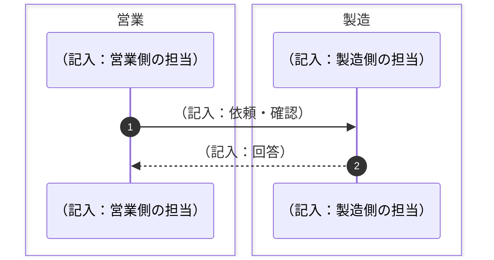

# システム化の背景・目的

*記入用の空テンプレート。書き方は [使い方](<[使い方]2-1_システム化の背景・目的.md>)、記入例は [サンプル](<[Sample]2-1_システム化の背景・目的.md>) を参照。*

## 1. システム化の背景

（記入：システム化以前に業務がどう回っていたかの概要。業務が複数ある場合は 1-1、1-2… の小節に分け、必要な小節に導入前の業務フロー図と「導入前の運用」の表を置く）

### 1-1. （業務名を記入）

- （記入）

### 1-2. （業務名を記入）

*図A：（記入：業務名）・導入前。記法は 3.1 業務フローと同じ（`box`＝組織、`Note over`＝工程、実線矢印＝依頼・実行、破線矢印＝回答）。*

- （記入）

| 項目 | 導入前の運用 |
| ---- | ------------ |
| （記入） | （記入） |

## 2. システム化の目的

- （記入）

## 3. 導入前とシステム化後の比較

| 業務 | 導入前（手作業） | 課題 | システム化後 |
| ---- | ---------------- | ---- | ------------ |
| （記入） | （記入） | （記入） | （記入） |

## 4. 対応方針

*具体的な開発方針は [開発方針（2.2）](<../2-2_開発方針/[Template]2-2_開発方針.md>) を正とする。ここでは背景に対応する方針の要点のみ示す。*

### ① （方針名を記入）

- （記入）

### ② （方針名を記入）

- （記入）

### ③ （方針名を記入）

- （記入）

---

## 文書情報

| 大分類 | 小分類 | ドキュメント名 | システムID | システム名 |
| ------ | ------ | -------------- | ---------- | ---------- |
| 2 | 2.1 | システム化の背景・目的 | （記入） | （記入） |

## 改定履歴

| Version | 計画書No. | 改訂日   | 改訂内容 | 担当者   | 課題No./備考 |
| ------- | --------- | -------- | -------- | -------- | ------------ |
| 1.0.0 | K2603-A002 | 2026-09-29 | 新規作成 | KCCS(岡) | - |
