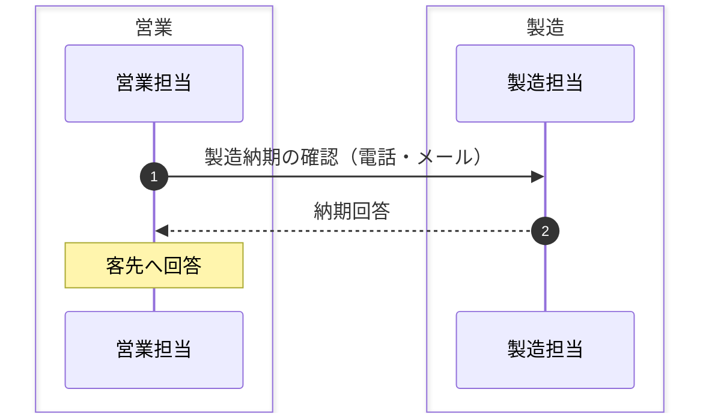

# システム化の背景・目的 — サンプル（記入例）

*記入イメージの例であり、実データではない。空テンプレートは 空テンプレート、書き方は 使い方 を参照。*

## 1. システム化の背景

（例）システム化以前、受注から製造依頼までが紙と Excel 台帳で運用されていた。業務は **受注管理** と **納期回答** に分かれる。

### 1-1. 受注管理

- （例）受注情報を Excel 台帳に転記し、製造依頼書を紙で発行していた。台帳が個人 PC に散在し、最新版がどれか分からなくなることがあった。

### 1-2. 納期回答

（例）客先からの納期照会に対し、営業が製造へ都度確認して回答していた（As-Is＝図A）。

*図A：納期回答・導入前。記法は 3.1 業務フローと同じ（`box`＝組織、`Note over`＝工程、実線矢印＝依頼・実行、破線矢印＝回答）。*

- （例）確認は毎日発生し、回答までに半日〜1 日を要していた。

| 項目 | 導入前の運用 |
| ---- | ------------ |
| 製造納期 | 毎日、営業担当から製造担当へ電話・メールで確認 |
| 受注残 | Excel 台帳を担当者ごとに管理 |

## 2. システム化の目的

- （例）受注情報を一元管理し、二重入力の排除と納期回答の迅速化を図る。
- （例）担当者が不在でも業務が回る状態にする（属人化の解消）。

## 3. 導入前とシステム化後の比較

| 業務 | 導入前（手作業） | 課題 | システム化後 |
| ---- | ---------------- | ---- | ------------ |
| 受注管理 | Excel 台帳に転記し製造依頼書を紙で発行 | 二重入力・最新版の所在が不明 | 受注情報を単一の DB で管理し、製造依頼をシステムから発行 |
| 納期回答 | 営業が製造へ都度確認して回答 | 回答までに半日〜1 日 | 製造納期をシステムで共有し、営業が即時回答 |

## 4. 対応方針

*（例）具体的な開発方針は [開発方針（2.2）](<[Sample]2-2_開発方針.md>) を正とする。ここでは背景に対応する方針の要点のみ示す。*

### ① 情報の一元化

- （例）注文データを単一のDBで管理し、各部門が同じ情報を参照する。

### ② 既存システムとの共存

- （例）現行の基幹システムとは段階的に連携し、一括移行は行わない。

### ③ 段階的な導入

- （例）まず受注・納期回答の範囲を対象とし、以降フェーズを分けて拡張する。

---

## 文書情報

| 大分類 | 小分類 | ドキュメント名 | システムID | システム名 |
| ------ | ------ | -------------- | ---------- | ---------- |
| 2 | 2.1 | システム化の背景・目的 | AZR | 納期管理システム |

## 改定履歴

| Version | 計画書No. | 改訂日     | 改訂内容 | 担当者 | 課題No./備考 |
| ------- | --------- | ---------- | -------- | ------ | ------------ |
| 1.0.0 | K2603-A002 | 2026-09-29 | 新規作成 | KCCS(岡) | - |
