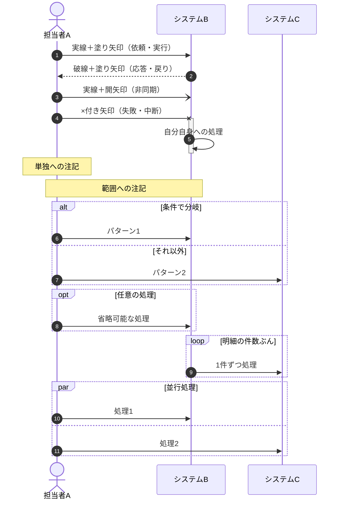

# 業務フロー — 使い方

*記入用の様式は [空テンプレート](<[Template]3-1_業務フロー.md>)、記入例は [サンプル](<[Sample]3-1_業務フロー.md>) を参照。*

## 1. 参考様式

*全注（全注文システム）基本設計書 `Ⅱ-1.業務ﾌﾛｰ.xlsx` の構成に合わせている。
見出し番号・表の列は全注の実ファイルのものを踏襲している。本システムで不要な列は削ってよい。*

## 2. 記法

*業務フローは Mermaid の **`sequenceDiagram`** で記述する。全注の原本はExcelの作図機能による
スイムレーン図だが、本サイトでは同じ意味を Mermaid で表す（テキストなので差分が追え、生成AIも図の内容を読める）。*

*`sequenceDiagram` を採用する理由は、**担当者が縦のレーンとして固定される**ため。
`flowchart` の `subgraph` でも担当者をグループ化できるが、自動レイアウトのためノードが増えると配置が崩れる。*

### 2-1. 書き方の決まり

| 項目 | 決まり |
| ---- | ------ |
| レーンのグループ化 | `box` で組織単位に色分けする（社外／営業側／製造側／システム 等） |
| 工程の区切り | `Note over` で「① 工程名」のように示す。背景色（`rect`）は使わない |
| 処理中の表現 | `activate` / `deactivate` で、いま誰が抱えているかを示す |
| 連番 | `autonumber` を付けてステップ番号を自動採番する |
| 用語 | 業務用語は [用語集](<../3-3_用語集/[Template]3-3_用語集.md>) に登録し、初出はリンクする |

### 2-2. 矢印の使い分け

| 記法 | 見た目 | 意味 |
| ---- | ------ | ---- |
| `A->>B` | 実線＋塗り矢印 | 依頼・実行 |
| `A-->>B` | 破線＋塗り矢印 | 応答・戻り |
| `A-)B` | 実線＋開矢印 | 非同期（投げっぱなし、後日連絡 等） |
| `A-xB` | ×付き矢印 | 失敗・中断 |

### 2-3. 制御構文

| 記法 | 用途 |
| ---- | ---- |
| `alt` / `else` | 条件による分岐 |
| `opt` | 任意（あってもなくてもよい処理） |
| `loop` | 繰り返し |
| `par` / `and` | 並行処理 |
| `critical` / `option` | 必ず実行する処理と、失敗時の処理 |

**記法サンプル（コピーして使う）**

> **📌 `flowchart` を使ってよい場合**
>
> *判断分岐が何段も入れ子になる業務は、`alt` を重ねると縦に伸びて読みづらくなる。
> その場合に限り `flowchart` を使ってよい（`A[業務]` 長方形、`A{条件}` 菱形、
> `A[/帳票/]` 平行四辺形、`A[(テーブル)]` 円筒）。
> ただし担当者の区別が付かなくなるため、原則は `sequenceDiagram` とする。*

## 3. 業務単位の分け方（現行／新の区分は設けない）

*全注の様式は業務フローを「現行／新」×「フェーズ」で分けていた（全注は現行業務を置き換える新規構築だったため）。
本システムは**稼働中システムのリバースエンジニアリング**であり、業務の変更（To-Be）が存在しないため、
**現行／新の区分は設けず、稼働中の業務（現行）のみを記述する**（SC様と合意、2026-08-25）。
空の「新業務フロー」や現行と同一内容の複製は、保守工程で生成AIに読ませた際に「変更が計画されている」と誤読させるため置かない。*

*節の単位は「フェーズ（一連の流れの区切り）」ではなく**業務単位**とする。本システムの業務は一連の流れとしてつながらず、
個別の業務に分かれるため（例：納期を回答する業務、納期を調整する業務、出荷に問題がないか確認する業務、実績・見込みを集計する業務）。*

| 決まり | 内容 |
| ------ | ---- |
| 業務一覧 | 空テンプレートの「1. 業務一覧」に、業務No.・業務名・範囲（起点〜終点）・主な関係者を全業務ぶん記入する。範囲は「何が起きたら始まり、何をもって終わるか」で書く |
| 節の追加 | 業務の数だけ `### 2-n.` を業務一覧の順に追加する（**1業務＝1図**）。業務一覧に無い業務の図は置かない |
| 粒度 | 業務の切り方・粒度は有識者ヒアリングの結果で調整する（フローの書き方自体には影響しない）。1図が縦に長くなりすぎる場合は業務を分ける |
| 業務間の参照 | ある業務から別の業務へつながる場合は、図中の `Note` またはメッセージ文で「（業務n ③へ）」のように業務No.と工程番号で示す |
| `box` の構成 | 組織レーン（`box`）の名称と並び順は全業務で揃える（登場しない組織は省いてよい） |
| 現行の明示 | 本文冒頭の一文（稼働中の業務をそのまま記述する）を残す。将来の変更案・改修案は本書に書かず、別案件の要件定義で扱う |

---

## 文書情報

| 大分類 | 小分類 | ドキュメント名 | システムID | システム名 |
| ------ | ------ | -------------- | ---------- | ---------- |
| 3 | 3.1 | 業務フロー（使い方） | （記入） | （記入） |

## 改定履歴

| Version | 計画書No. | 改訂日     | 改訂内容 | 担当者 | 課題No./備考 |
| ------- | --------- | ---------- | -------- | ------ | ------------ |
| 1.0.0 | K2603-A002 | 2026-09-29 | 新規作成 | KCCS(岡) | - |
