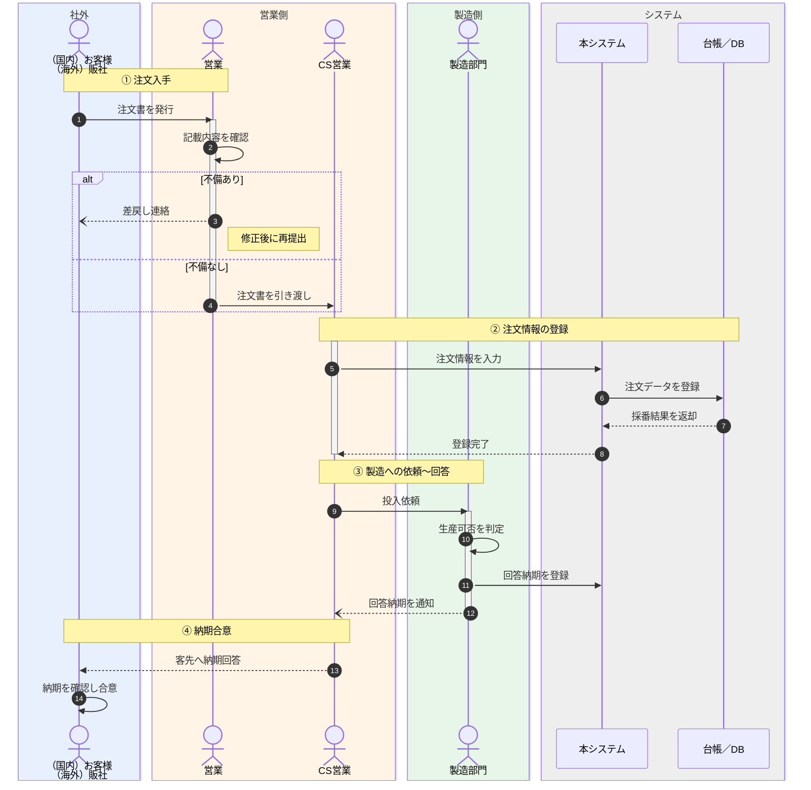
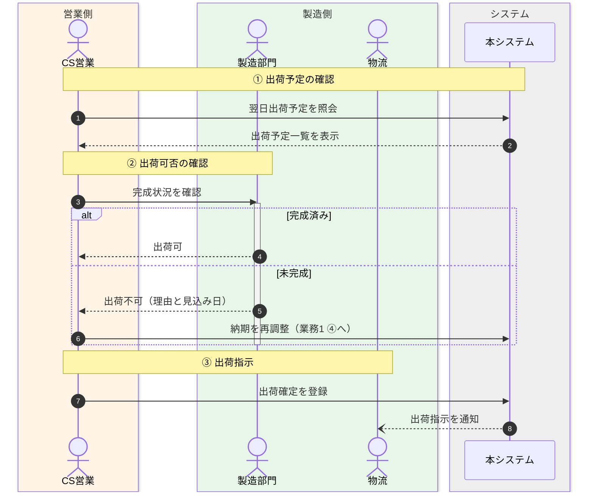

# 業務フロー — サンプル（記入例）

/// tab | 本文

*記入イメージの例であり、実データではない。空テンプレートは 空テンプレート、記法は 使い方 を参照。
本書は稼働中システムで行われている業務をそのまま記述する（現行のみ）。将来の業務変更案・改修案は本書に含めない。*

## 1. 業務一覧

| 業務No. | 業務名 | 範囲（起点〜終点） | 主な関係者 |
| ------- | ------ | ------------------ | ---------- |
| 1 | 納期回答 | 客先の注文書受領から、客先への納期回答・合意まで | お客様／販社、営業、CS営業、製造部門 |
| 2 | 出荷確認 | 出荷予定日の前日確認から、出荷可否の確定まで | CS営業、製造部門、物流 |

## 2. 業務フロー

### 2-1. ＜業務1：納期回答＞

### 2-2. ＜業務2：出荷確認＞

///

/// tab | 文書情報・改定履歴

## 文書情報

| 大分類 | 小分類 | ドキュメント名 | システムID | システム名 |
| ------ | ------ | -------------- | ---------- | ---------- |
| 3 | 3.1 | 業務フロー | AZR | 納期管理システム |

## 改定履歴

| Version | 計画書No. | 改訂日     | 改訂内容 | 担当者 | 課題No./備考 |
| ------- | --------- | ---------- | -------- | ------ | ------------ |
| 1.0.0 | K2603-A002 | 2026-09-29 | 新規作成 | KCCS(岡) | - |

///
