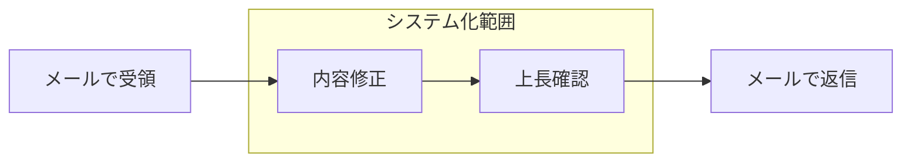

# ビジネスルール — サンプル（記入例）

*記入イメージの例であり、実データではない。空テンプレートは 空テンプレート、書き方は 使い方 を参照。*

## 1. システム化範囲

- （例）注文の受領から返信までのうち、内容修正・上長確認をシステム化の対象とする。

## 2. 業務ルール

### 2-1. 見込No.の扱い

*（例）確定前の注文は「見込No.」で仮採番し、客先確定時に正式な注番へ引き継ぐ。*

| No. | パターン | 条件 | 扱い |
| --- | -------- | ---- | ---- |
| 1 | 仮採番 | 引合・見積段階 | 見込No.を採番して管理する |
| 2 | 確定引継ぎ | 客先から確定連絡 | 見込No.を正式注番に変換し、対応関係を履歴に残す |

---

## 文書情報

| 大分類 | 小分類 | ドキュメント名 | システムID | システム名 |
| ------ | ------ | -------------- | ---------- | ---------- |
| 3 | 3.2 | ビジネスルール | AZR | 納期管理システム |

## 改定履歴

| Version | 計画書No. | 改訂日     | 改訂内容 | 担当者 | 課題No./備考 |
| ------- | --------- | ---------- | -------- | ------ | ------------ |
| 1.0.0 | K2603-A002 | 2026-09-29 | 新規作成 | KCCS(岡) | - |
