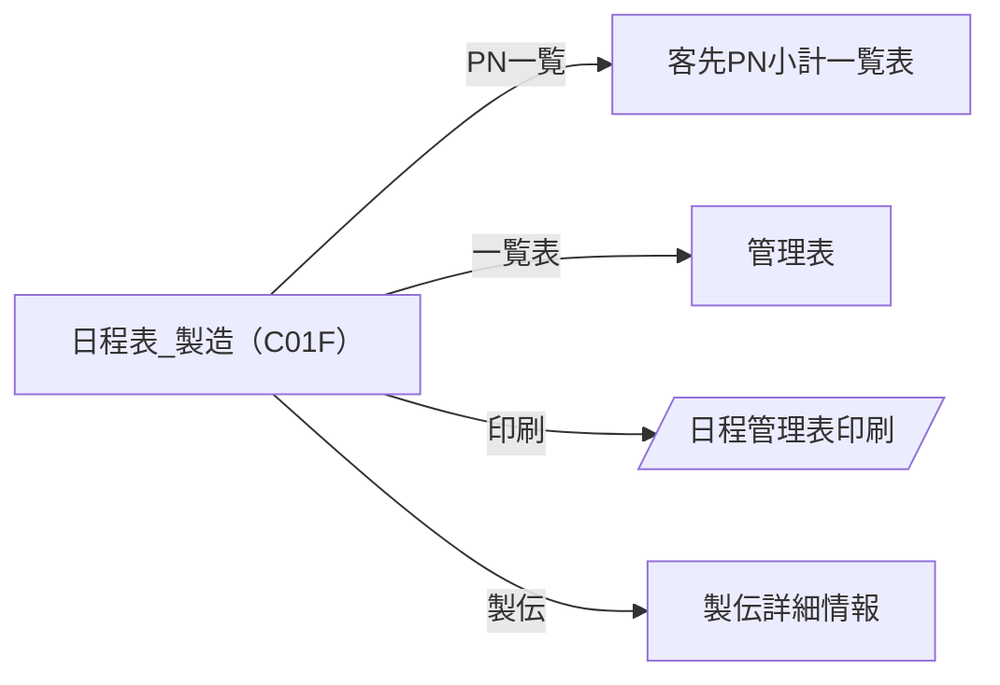
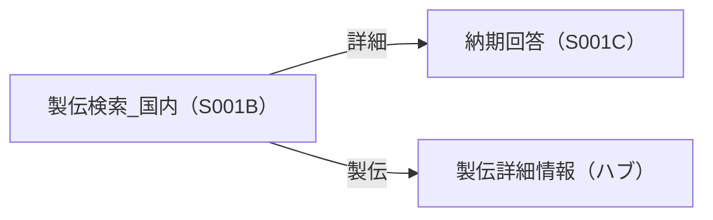

# 概略オペレーションフロー — サンプル（記入例）

*記入イメージの例であり、実データではない。空テンプレートは [空テンプレート](<[Template]5-2_概略オペレーションフロー.md>)、凡例・書き方は [使い方](<[使い方]5-2_概略オペレーションフロー.md>) を参照。
画面ID・機能IDは [システム機能一覧（6.1）](<../../06-システム設計書（一覧、管理台帳）/6-1_システム機能一覧/[Sample]6-1_システム機能一覧.md>)、画面台帳は [画面・帳票一覧（6.2）](<../../06-システム設計書（一覧、管理台帳）/6-2_画面・帳票一覧/[Sample]6-2_画面・帳票一覧.md>) を正として突合する。*

## 1. 全画面共通の遷移ルール

| No. | ルール |
| --- | ------ |
| 1 | ログイン後のトップ画面（`M001` 生産実績更新時間）を経由してメニューから各機能へ遷移する（各フロー図では「メニュー」から開始し、共通部分は省略） |
| 2 | 各画面のヘッダーのメニューリンクから他機能の検索画面へ遷移できる（図では省略） |

## 2. 利用ユーザー種別

*権限は [ユーザーグループ（権限）一覧（5-8）](<../5-8_ユーザーグループ（権限）一覧/[Template]5-8_ユーザーグループ（権限）一覧.md>) と対応させる。*

| ユーザー種別 | 説明 | 主に利用する機能（部門・機能ID） |
| ------------ | ---- | -------------------------------- |
| 営業（国内） | 国内営業担当 | 営業／`S001B` 製伝検索_国内・`S001C` 納期回答 ほか |
| 営業（海外ISD） | 海外営業担当 | 営業／`S001D` 製伝検索_ISD・`S001E` 製伝詳細画面 ほか |
| 製造 | 製造担当 | 製造／`P001B` 製伝検索_製造 ほか |

## 3. 部門×機能ID別フロー

> **📌 3-1 業務フローとの違い（重複させない）**
>
> *本節は「システムを**どの画面→どの画面**で操作するか」に特化する。業務全体の流れ（組織横断・電話・紙などシステム外を含む）は [業務フロー（3-1）](<../../03-業務設計書/3-1_業務フロー/[Template]3-1_業務フロー.md>) が正。画面内部の詳細は機能定義書（8章）へ委ねる。*

### 製造

#### P001A 日程表_製造（C01F）

| 手順 | 操作（ボタン名） | 遷移元画面ID | 遷移先画面ID | 区分 | 備考 |
| ---- | ---------------- | ------------ | ------------ | ---- | ---- |
| 1 | PN一覧 | C01F（日程表_製造） | 客先PN小計一覧表 | 副次 | |
| 2 | 一覧表 | C01F | 管理表 | 副次 | |
| 3 | 印刷 | C01F | 日程管理表印刷 | 帳票出力 | 帳票（印刷） |
| 4 | 製伝 | C01F | 製伝詳細情報 | 主フロー | 製伝詳細情報はハブ画面 |

### 営業

#### S001B 製伝検索_国内（国内の納期回答）

| 手順 | 操作（ボタン名） | 遷移元画面ID | 遷移先画面ID | 区分 | 備考 |
| ---- | ---------------- | ------------ | ------------ | ---- | ---- |
| 1 | 詳細（対象製伝を選択） | S001B | S001C | 主フロー | |
| 2 | 製伝 | S001B | 製伝詳細情報 | 副次 | ハブ画面（複数フローに登場） |

*ハブ画面「製伝詳細情報」は、日程表_製造・製伝検索など複数の機能IDのフローに登場する（**同一画面の複数登場はOK**）。*

## 4. 共通系画面（後日追加）

*部門「共通」（例：`M001` 生産実績更新時間・`M002` 製伝納期の変更履歴・`M003` 納期回答の履歴検索）や、複数機能から共有される共通系画面は、SC側でも把握し切れていないため、画面設計書等が揃った後に追加する。判明するまでは網羅チェックの対象から暫定的に除外する。*

## 5. スコープ外の画面

| No. | 画面ID | 画面名 | 対象外とした理由 | 対応予定 |
| --- | ------ | ------ | ---------------- | -------- |
| 1 | S032A | 積層日数マスタ画面 | 現行で使用していないため（6.1 備考） | 未定 |

---

## 文書情報

| 大分類 | 小分類 | ドキュメント名 | システムID | システム名 |
| ------ | ------ | -------------- | ---------- | ---------- |
| 5 | 5.2 | 概略オペレーションフロー | AZR | 納期管理システム |

## 改定履歴

| Version | 計画書No. | 改訂日     | 改訂内容 | 担当者 | 課題No./備考 |
| ------- | --------- | ---------- | -------- | ------ | ------------ |
| 1.0.0 | K2603-A002 | 2026-09-29 | 新規作成 | KCCS(岡) | - |
