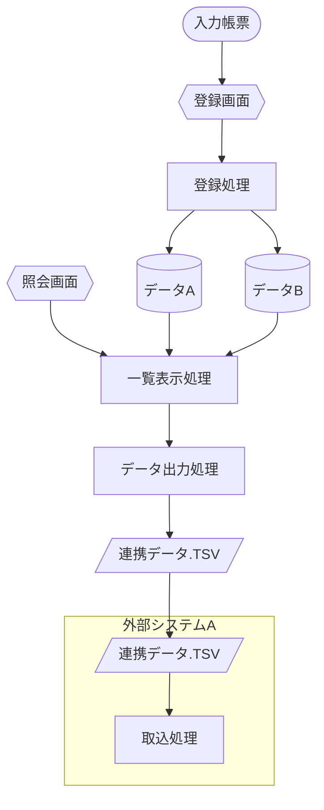
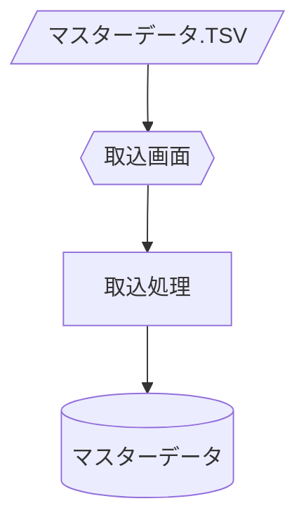

# システムフロー（データフロー）（使い方）

## 1. 使い方

このファイルは新しいシステムフロー図ページを追加する際の**空のひな形**（実データを含まない）。
記入例（架空データ）は [\[Sample\]5-3_システムフロー（データフロー）](<[Sample]5-3_システムフロー（データフロー）.md>) を参照する（実データ版はソースコードからの抽出後に差し替える）。

本テンプレートは、各章で何を・どこから抽出すべきかの説明を各項目・各図の直下に直接記載してある
ので、そちらを見ながら埋めていけばよい。

**追加手順**

1. 対象部門（処理区分）ごとに、本システムに存在するすべてのフローを洗い出す。1部門に複数のフロー
   がある場合は、部門見出しの配下にフロー見出しを複数並べる。
2. フローごとに、実際の画面・バッチ・DB・外部I/Fの関係をソースコード（Entity/Control/Servlet、
   バッチ定義）で確認したうえで、Mermaidの`flowchart`記法で図示する。自作の推測フローを描かない。
3. 「図形の凡例」に従い、図形の使い分けを統一する（円柱＝データストア、六角形＝オンライン画面処理
   など）。
4. 洗い替え型の一括バッチ更新など、通常のインライン更新と異なる特性がある場合は、注記として明記
   する（[\[Sample\]5-3_システムフロー（データフロー）](<[Sample]5-3_システムフロー（データフロー）.md>) の図末尾の注記を参照）。
5. 完成したら、`[Sample]5-3_システムフロー（データフロー）.md`側へ実データとして追記する（本ひな形自体に
   実データを書き込まない）。

## 共通の記入ルール

「ほか」「等」での省略禁止／1件＝1行／グループ化した行でもキー列を空欄にしない、の3点は [記述ルール 節10「列挙と行の書き方」](<../5-9_標準設計書/5-9-1_記述ルール/[Sample]5-9-1_記述ルール.md#10-列挙と行の書き方一覧表の共通ルール>) を正とする（各ページに重複記載しない）。

## 2. システムフロー図

*本システムに存在するすべてのフローを、対象部門（処理区分）ごとにグループ化してここに列挙すること。
まず対象部門の見出しを立て、その配下に、その部門に関連するフローの見出しとMermaid図を並べる。*

### （対象部門：《部門名》）

#### 《フロー名》

#### 《フロー名2》

## 3. 図形の凡例（参考）

*KCCS本サンプルで確認された図形とその意味は次のとおり。*

| 図形             | 意味                               | Mermaid記法              |
| ---------------- | ----------------------------------- | ------------------------- |
| 円柱             | データストア（ファイル／DB）        | `[(名称)]`                |
| 六角形           | オンライン画面処理                   | `{{名称}}`                |
| 平行四辺形       | ファイル入出力（外部I/F）           | `[/名称/]`                |
| 波型下端の書類   | 帳票・原始伝票（紙媒体）             | `([名称])`                |
| 長方形           | 処理（バッチ／オンライン処理）       | `[名称]`                  |
| 角丸四角形の枠   | 外部システム枠                       | `subgraph 名称 ... end`   |
| 矢印             | データの流れの向き                   | `-->`                     |

---

## 文書情報

| 大分類 | 小分類 | ドキュメント名 | システムID | システム名 |
| ------ | ------ | -------------- | ---------- | ---------- |
| 5 | 5.3 | システムフロー（データフロー）（使い方） | （記入） | （記入） |

## 改定履歴

| Version | 計画書No. | 改訂日     | 改訂内容 | 担当者 | 課題No./備考 |
| ------- | --------- | ---------- | -------- | ------ | ------------ |
| 1.0.0 | K2603-A002 | 2026-09-29 | 新規作成 | KCCS(岡) | - |
