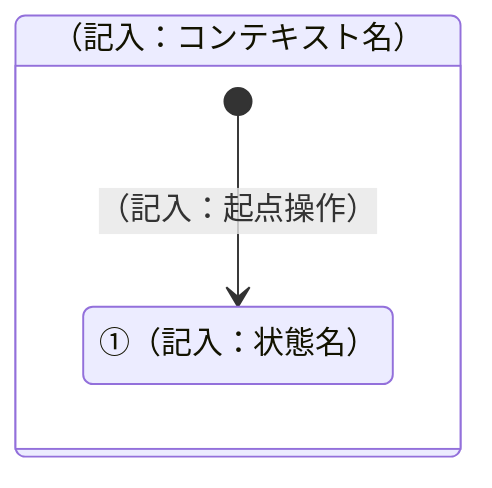

# 状態遷移図

## 1. ステータス分類一覧

| No. | コード | 大分類 | 種類 | 画面出力名称 | 内容 |
| --- | ------ | ------ | ---- | ------------ | ---- |
| （記入） | （記入） | （記入） | （記入） | （記入） | （記入） |
|  |  |  |  |  |  |

## 2. ステータス定義（分類ごと）

**No.1　（記入：大分類名）**

| No. | 種類 | コード | ステータス名 | 内容 |
| --- | ---- | ------ | ------------- | ---- |
| （記入） | （記入） | （記入） | （記入） | （記入） |
|  |  |  |  |  |

## 3. 図形の凡例

| 図形／背景色                                     | 意味                                                                       |
| --------------------------------------------------- | ------------------------------------------------------------------------------ |
| 背景色付きの大枠（見出し「●コンテキストステータスの値」） | コンテキストステータス（上位ステータス）が特定の値であるときの文脈。配下に、その文脈で取り得る詳細ステータスを一式描画する |
| 角丸四角形のグループ枠（複数の状態コードを内包）    | 業務上同じ意味を持つ複数の状態コードをまとめた上位グループ（スーパーステート）  |
| 四角形（白背景・黒枠）                               | 個々の状態ノード（1行目＝コード、2行目＝状態名）                              |
| 点線の枠（画面名を列挙）                            | その状態への遷移を引き起こす起点となる画面・操作                              |
| 角丸四角形（青背景・白文字）                        | 遷移のトリガーとなるボタン名（矢印のラベルとして機能）                        |
| 角丸四角形（緑背景・白文字、"　"付き）              | 上位ステータス自体を別の値に変更するアノテーション（他の●シナリオ枠へ接続される） |
| 矢印（色は複数種）                                  | 遷移の向き。色分けは枠をまたぐ配線が交差する際の見分け用であり、色自体に意味の違いはない |

## 4. 状態遷移図

### ■（記入：種類名）

---

## 文書情報

| 大分類 | 小分類 | ドキュメント名 | システムID | システム名 |
| ------ | ------ | -------------- | ---------- | ---------- |
| 5 | 5.6 | 状態遷移図 | （記入） | （記入） |

## 改定履歴

| Version | 計画書No. | 改訂日     | 改訂内容                                                                         | 担当者 | 課題No./備考 |
| ------- | --------- | ---------- | ---------------------------------------------------------------------------------- | ------ | ------------ |
| 1.0.0 | K2603-A002 | 2026-09-29 | 新規作成 | KCCS(岡) | - |
