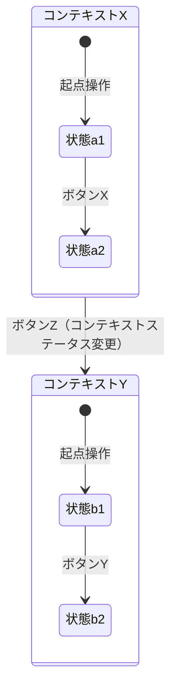
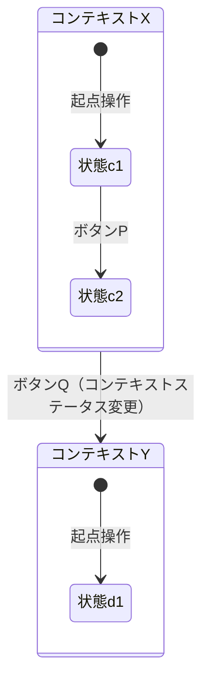

# 状態遷移図（使い方）

## 1. 使い方

このファイルは新しい状態遷移図ページを追加する際の**空のひな形**（実データを含まない）。記入例
（架空データ）は [\[Sample\]5-6_状態遷移図](<[Sample]5-6_状態遷移図.md>) を参照する（実データ版はソースコードからの抽出後に差し替える）。

**追加手順**

1. 対象データが持つステータスをコード帯（先頭桁等）で分類し、「ステータス分類一覧」を作成する。
   1つの分類に複数の「種類」がある場合は行を分ける。
2. 分類（No.）ごとに、実際に取り得るコード・ステータス名・意味を「ステータス定義（分類ごと）」に
   列挙する。
3. 「サブセクションの分け方」に従い、■（種類）ごとに図を分け、■の配下で状態遷移に影響する別の
   上位ステータス（コンテキストステータス）の値ごとに●で細分化する。
4. Mermaidの`stateDiagram-v2`記法で状態遷移図を作成する。コンテキストステータスの値（●）は`state`
   の複合状態（composite state）として表現し、ボタン名は遷移のラベルとして記載する。
5. 対象データが、単一の状態遷移関数・テーブルとしてコード上に実在するのか、複数画面がそれぞれ独自
   に微妙に異なる条件分岐を実装しているだけなのかを確認する。後者の場合は、図を「複数画面のロジッ
   クを重ね合わせて一般化した図」である旨を注記し、画面間のロジック重複自体もレビュー対象として
   正直に報告する。
6. 断定できない遷移条件は「不明」「要確認」と明記し、推測で埋めない。

## 共通の記入ルール

「ほか」「等」での省略禁止／1件＝1行／グループ化した行でもキー列を空欄にしない、の3点は [記述ルール 節10「列挙と行の書き方」](<../5-9_標準設計書/5-9-1_記述ルール/[Sample]5-9-1_記述ルール.md#10-列挙と行の書き方一覧表の共通ルール>) を正とする（各ページに重複記載しない）。

## 2. ステータス分類一覧

*対象データが持つステータスを、コード帯（先頭桁等）で分類した一覧。1つの分類に複数の「種類」がある
場合（例：同じ「納期ステータス」でも客先向け・製造向けで別系統に分かれる場合）は行を分ける。*

| No. | コード | 大分類     | 種類     | 画面出力名称 | 内容                                     |
| --- | ------ | ---------- | -------- | ------------ | ------------------------------------------- |
| （記入） | （記入） | （記入） | （記入） | （記入）     | （記入：このステータスが何を管理するかの説明） |
| …  | …     | …         | …       | …           | …                                           |

## 3. ステータス定義（分類ごと）

*上の分類（No.）ごとに、実際に取り得るコード・ステータス名・意味を列挙する。1分類に複数の「種類」
がある場合は種類ごとに小テーブルを分ける。*

**No.1　（記入：大分類名）**

| No. | 種類    | コード | ステータス名 | 内容                             |
| --- | ------- | ------ | ------------- | ---------------------------------- |
| （記入） | （記入） | （記入） | （記入） | （記入）                          |
| …  | …      | …     | …            | …                                   |

*複数の「種類」を組み合わせて1つのコードを合成する運用を取る場合は、この直後に組み合わせ表を追加
する。全システムで必須の構成ではないため、必要な場合のみ追加すること。*

## 4. サブセクションの分け方

*状態遷移図は2段階のサブセクションに分かれる。分け方の条件はそれぞれ異なるため、作成時に混同しない
こと。*

| 段階                       | 分ける条件                                                                                   |
| ---------------------------- | ------------------------------------------------------------------------------------------------ |
| ■（大見出し）              | 「ステータス分類一覧」で定義した「種類」ごと。1分類に「種類」が1つしかない場合は■を作らず、直接ステータス遷移図に進む |
| ●（■の配下）               | その状態遷移に影響する別の上位ステータス（コンテキストステータス）の値ごと。この上位ステータス自体は「ステータス分類一覧」には含まれない、遷移条件としてのみ登場する状態でよい |

*●の分け方が分からない場合の見分け方：同じ3〜5種類の値が、■の異なるブロックで繰り返し見出しに使わ
れていれば、それが「コンテキストステータス」である可能性が高い。*

## 5. 図形の凡例

*元のExcelでは、状態遷移をセルの文字ではなく図形（枠・矢印）で手描きしている場合がある。図形とその
意味は次のとおり。Mermaidで作成する際は、対応する記法に置き換える。*

| 図形／背景色                                     | 意味                                                                       |
| --------------------------------------------------- | ------------------------------------------------------------------------------ |
| 背景色付きの大枠（見出し「●コンテキストステータスの値」） | コンテキストステータス（上位ステータス）が特定の値であるときの文脈。配下に、その文脈で取り得る詳細ステータスを一式描画する |
| 角丸四角形のグループ枠（複数の状態コードを内包）    | 業務上同じ意味を持つ複数の状態コードをまとめた上位グループ（スーパーステート）  |
| 四角形（白背景・黒枠）                               | 個々の状態ノード（1行目＝コード、2行目＝状態名）                              |
| 点線の枠（画面名を列挙）                            | その状態への遷移を引き起こす起点となる画面・操作                              |
| 角丸四角形（青背景・白文字）                        | 遷移のトリガーとなるボタン名（矢印のラベルとして機能）                        |
| 角丸四角形（緑背景・白文字、"　"付き）              | 上位ステータス自体を別の値に変更するアノテーション（他の●シナリオ枠へ接続される） |
| 矢印（色は複数種）                                  | 遷移の向き。色分けは枠をまたぐ配線が交差する際の見分け用であり、色自体に意味の違いはない |

## 6. 状態遷移図

*本サイトが対応している Mermaid の `stateDiagram-v2` 記法で記述することを推奨する。「サブセクション
の分け方」のとおり、■（種類）ごとに図を分け、各図の中でコンテキストステータスの値（●）を`state`の
複合状態（composite state）として表現する。ボタン名は遷移のラベルとして記載する。*

> *以下は記法例（プレースホルダー）。実際の作成時は、対象データの種類名・状態名・遷移条件・ボタン
> 名に置き換えること。*

### ■種類A

### ■種類B

*種類が変わっても、コンテキストステータスの値（コンテキストX／コンテキストY）は種類Aと共通である
点に注意。図は種類ごとに分けるが、コンテキストの区分自体は使い回す。*

---

## 文書情報

| 大分類 | 小分類 | ドキュメント名 | システムID | システム名 |
| ------ | ------ | -------------- | ---------- | ---------- |
| 5 | 5.6 | 状態遷移図（使い方） | （記入） | （記入） |

## 改定履歴

| Version | 計画書No. | 改訂日     | 改訂内容 | 担当者 | 課題No./備考 |
| ------- | --------- | ---------- | -------- | ------ | ------------ |
| 1.0.0 | K2603-A002 | 2026-09-29 | 新規作成 | KCCS(岡) | - |
