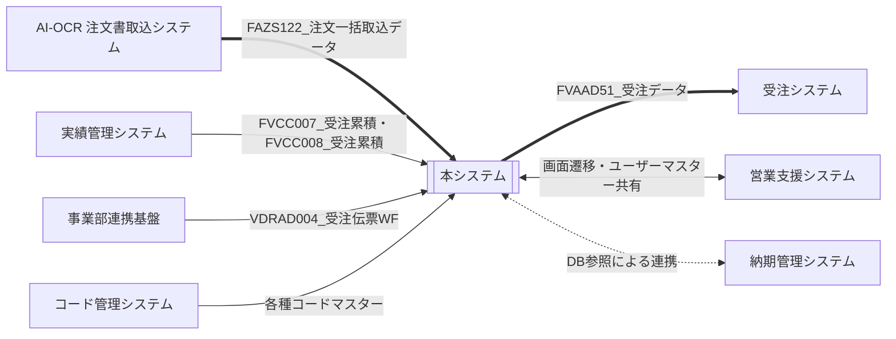

# システム関連図 — サンプル（記入例）

/// tab | 本文

*記入イメージの例であり、実データではない。空テンプレートは 空テンプレート、凡例は 使い方 を参照。*

## 1. システム関連図

## 2. 連携システム一覧

| No. | システム名 | 方向 | 連携区分 | 主な連携データ | 備考 |
| --- | ---------- | ---- | -------- | -------------- | ---- |
| 1 | AI-OCR 注文書取込システム | 着信 | 新規・変更 | `FAZS122_注文一括取込データ` | |
| 2 | 受注システム | 発信 | 既存 | `FVAAD51_受注データ` | |
| 3 | 営業支援システム | 双方向 | 既存 | 画面遷移・ユーザーマスター共有 | |

## 3. 連携対象外としたシステム

| No. | システム名 | 対象外とした理由 |
| --- | ---------- | ---------------- |
| 1 | 実績管理システム | 納期管理システム経由でDB参照するため、直接連携しない |

///

/// tab | 文書情報・改定履歴

## 文書情報

| 大分類 | 小分類 | ドキュメント名 | システムID | システム名 |
| ------ | ------ | -------------- | ---------- | ---------- |
| 5 | 5.1 | システム関連図 | AZR | 納期管理システム |

## 改定履歴

| Version | 計画書No. | 改訂日     | 改訂内容 | 担当者 | 課題No./備考 |
| ------- | --------- | ---------- | -------- | ------ | ------------ |
| 1.0.0 | K2603-A002 | 2026-09-29 | 新規作成 | KCCS(岡) | - |

///
