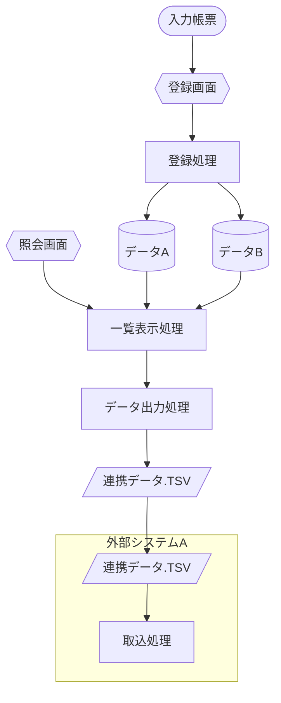
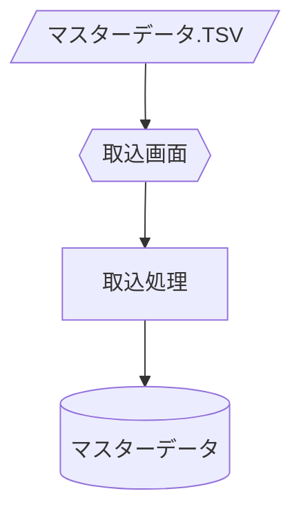

# システムフロー（データフロー）

*本ページは架空データによる記入例（旧 [Template] の記入例を 2026-09-11 に分離）。実データ版はソースコードからの抽出後に差し替える。空のひな形は \[Template\]5-3_システムフロー（データフロー）。*

## 1. システムフロー図

### （対象部門：《部門名》）

#### 《フロー名》

#### 《フロー名2》

## 2. 図形の凡例

| 図形             | 意味                               | Mermaid記法              |
| ---------------- | ----------------------------------- | ------------------------- |
| 円柱             | データストア（ファイル／DB）        | `[(名称)]`                |
| 六角形           | オンライン画面処理                   | `{{名称}}`                |
| 平行四辺形       | ファイル入出力（外部I/F）           | `[/名称/]`                |
| 波型下端の書類   | 帳票・原始伝票（紙媒体）             | `([名称])`                |
| 長方形           | 処理（バッチ／オンライン処理）       | `[名称]`                  |
| 角丸四角形の枠   | 外部システム枠                       | `subgraph 名称 ... end`   |
| 矢印             | データの流れの向き                   | `-->`                     |

---

## 文書情報

| 大分類 | 小分類 | ドキュメント名 | システムID | システム名 |
| ------ | ------ | -------------- | ---------- | ---------- |
| 5 | 5.3 | システムフロー（データフロー） | （記入） | （記入） |

## 改定履歴

| Version | 計画書No. | 改訂日     | 改訂内容                                                                         | 担当者 | 課題No./備考 |
| ------- | --------- | ---------- | ---------------------------------------------------------------------------------- | ------ | ------------ |
| 1.0.0 | K2603-A002 | 2026-09-29 | 新規作成 | KCCS(岡) | - |
