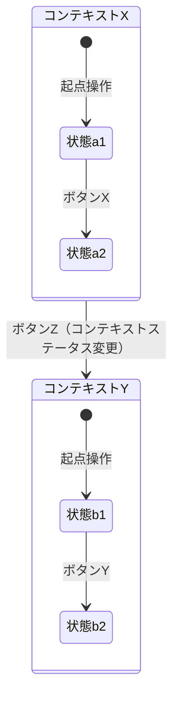
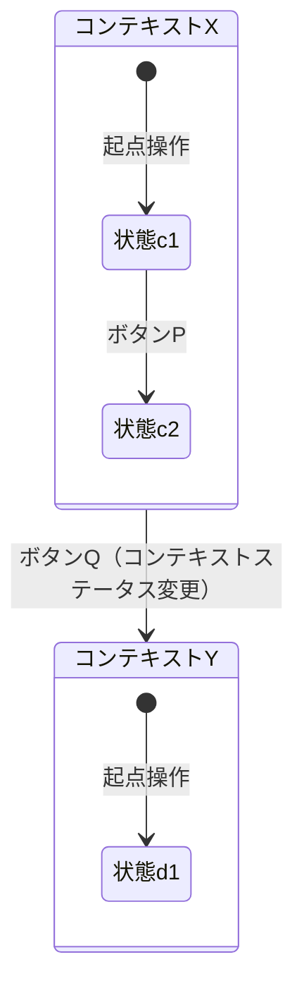

# 状態遷移図

*本ページは架空データによる記入例（旧 [Template] の記入例を 2026-09-11 に分離）。実データ版はソースコードからの抽出後に差し替える。空のひな形は \[Template\]5-6_状態遷移図。*

## 1. ステータス分類一覧

| No. | コード | 大分類     | 種類     | 画面出力名称 | 内容                                     |
| --- | ------ | ---------- | -------- | ------------ | ------------------------------------------- |
| 1   | 1XX    | ステータスA | 種類A-1  | 表示名A      | このステータスが何を管理するかの説明        |
| 1   | 1XX    | ステータスA | 種類A-2  | 表示名B      | このステータスが何を管理するかの説明        |
| 2   | 2XX    | ステータスB | 種類B    | 表示名C      | このステータスが何を管理するかの説明        |
| …  | …     | …         | …       | …           | …                                           |

## 2. ステータス定義（分類ごと）

**No.1　ステータスA**

| No. | 種類    | コード | ステータス名 | 内容                             |
| --- | ------- | ------ | ------------- | ---------------------------------- |
| 1   | 種類A-1 | 10X    | -             | 未着手・未投入の状態                |
| 1   | 種類A-1 | 11X    | 未回答        | 対応待ちの状態                      |
| 1   | 種類A-1 | 19X    | 回答済        | 対応済みの状態                      |
| 2   | 種類A-2 | 1X1    | ドラフト      | 一時保存された状態                  |
| …  | …      | …     | …            | …                                   |

## 3. 図形の凡例

| 図形／背景色                                     | 意味                                                                       |
| --------------------------------------------------- | ------------------------------------------------------------------------------ |
| 背景色付きの大枠（見出し「●コンテキストステータスの値」） | コンテキストステータス（上位ステータス）が特定の値であるときの文脈。配下に、その文脈で取り得る詳細ステータスを一式描画する |
| 角丸四角形のグループ枠（複数の状態コードを内包）    | 業務上同じ意味を持つ複数の状態コードをまとめた上位グループ（スーパーステート）  |
| 四角形（白背景・黒枠）                               | 個々の状態ノード（1行目＝コード、2行目＝状態名）                              |
| 点線の枠（画面名を列挙）                            | その状態への遷移を引き起こす起点となる画面・操作                              |
| 角丸四角形（青背景・白文字）                        | 遷移のトリガーとなるボタン名（矢印のラベルとして機能）                        |
| 角丸四角形（緑背景・白文字、"　"付き）              | 上位ステータス自体を別の値に変更するアノテーション（他の●シナリオ枠へ接続される） |
| 矢印（色は複数種）                                  | 遷移の向き。色分けは枠をまたぐ配線が交差する際の見分け用であり、色自体に意味の違いはない |

## 4. 状態遷移図

### ■種類A

### ■種類B

---

## 文書情報

| 大分類 | 小分類 | ドキュメント名 | システムID | システム名 |
| ------ | ------ | -------------- | ---------- | ---------- |
| 5 | 5.6 | 状態遷移図 | （記入） | （記入） |

## 改定履歴

| Version | 計画書No. | 改訂日     | 改訂内容                                                                         | 担当者 | 課題No./備考 |
| ------- | --------- | ---------- | ---------------------------------------------------------------------------------- | ------ | ------------ |
| 1.0.0 | K2603-A002 | 2026-09-29 | 新規作成 | KCCS(岡) | - |
