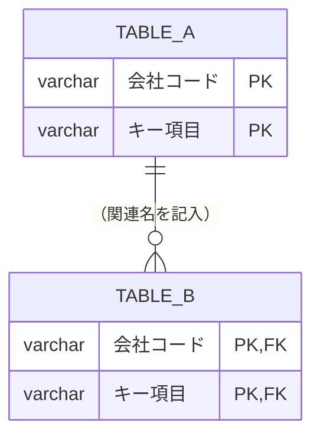

# DB関連図（ER図）

*記入用の空テンプレート。書き方は [使い方](<[使い方]7-3_DB関連図（ER図）.md>)、記入例は [サンプル](<[Sample]7-3_DB関連図（ER図）.md>) を参照。*

## 1. ER図（業務領域別・俯瞰）

### 1-1. （業務領域名を記入）

*※業務領域ごとに `### 1-2.` `### 1-3.` … と小節を分ける（1枚あたり10テーブル程度）。*

## 2. リレーション一覧

| No. | 親テーブル | 子テーブル | カーディナリティ | 結合キー | 業務領域（図の節） | 備考 |
| --- | ---------- | ---------- | ---------------- | -------- | ------------------ | ---- |
| 1 | `TABLE_A` | `TABLE_B` | 1:N | 会社コード, キー項目 | 1-1 | |

---

## 文書情報

| 大分類 | 小分類 | ドキュメント名 | システムID | システム名 |
| ------ | ------ | -------------- | ---------- | ---------- |
| 7 | 7.3 | DB関連図（ER図） | （記入） | （記入） |

## 改定履歴

| Version | 計画書No. | 改訂日   | 改訂内容 | 担当者   | 課題No./備考 |
| ------- | --------- | -------- | -------- | -------- | ------------ |
| 1.0.0 | K2603-A002 | 2026-09-29 | 新規作成 | KCCS(岡) | - |
