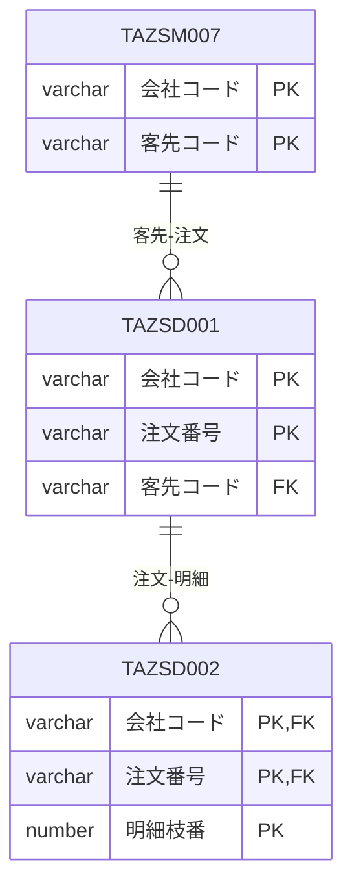

# DB関連図（ER図） — サンプル（記入例）

*記入イメージの例であり、実データではない。空テンプレートは 空テンプレート、書き方は 使い方 を参照。*

## 1. ER図（業務領域別・俯瞰）

### 1-1. 注文まわり

## 2. リレーション一覧

| No. | 親テーブル | 子テーブル | カーディナリティ | 結合キー | 業務領域（図の節） | 備考 |
| --- | ---------- | ---------- | ---------------- | -------- | ------------------ | ---- |
| 1 | `TAZSD001` | `TAZSD002` | 1:N | 会社コード, 注文番号 | 1-1 | |
| 2 | `TAZSM007` | `TAZSD001` | 1:N | 会社コード, 客先コード | 1-1 | 論理のみ（FK制約なし） |

---

## 文書情報

| 大分類 | 小分類 | ドキュメント名 | システムID | システム名 |
| ------ | ------ | -------------- | ---------- | ---------- |
| 7 | 7.3 | DB関連図（ER図） | AZR | 納期管理システム |

## 改定履歴

| Version | 計画書No. | 改訂日     | 改訂内容 | 担当者 | 課題No./備考 |
| ------- | --------- | ---------- | -------- | ------ | ------------ |
| 1.0.0 | K2603-A002 | 2026-09-29 | 新規作成 | KCCS(岡) | - |
