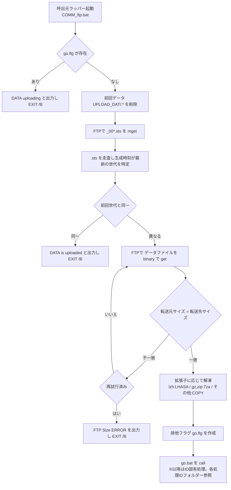

# 処理フロー

## 1. 実行順序（ジョブネット）

本ファイル自身のソースコードから読み取れる `call` 関係のみ（起動時刻・周期はタスクスケジューラ由来のため書かない）。概要のみを示し、引数・接続先は[外部リクエスト仕様](COMM_ftp_08_外部リクエスト仕様.md)を参照。

| 実行順 | 処理ID／プログラム名 | 区分 | 備考 |
| ------ | -------------------- | ---- | ---- |
| 1 | `COMM_FTP_<ID>.bat`（例：[COMM_FTP_FVCC011](<../[Sample]COMM_FTP_FVCC011/index.md>)） | 先行 | 薄いラッパー。タスクスケジューラから起動され、本エンジンを `call` する。詳細は外部リクエスト仕様「5. 呼出元一覧」 |
| 2 | `COMM_ftp.bat` | **本バッチ** | 第1引数 `<ID>` で取得対象と呼出先が決まる |
| 3 | `go<ID>.bat`（例：[goFVCC011](<../[Sample]goFVCC011/index.md>)） | 後続 | 排他フラグ作成後に `call`。詳細は外部リクエスト仕様「3. 呼び出し一覧」 |

## 2. 処理フロー図

（`<ID>`は呼出元ラッパーから渡される第1引数。`go<ID>.bat`以降のID固有処理は本図に含まず、
`go<ID>.bat`自身のフォルダー（例：[goFVCC011](<../[Sample]goFVCC011/index.md>)）の処理フロー図を参照）

## 3. 処理ステップ（プロセス記述）

`No.` は上記フロー図のノードと対応する（旧「プロセス記述書」を本ページに統合）。

| No. | 処理内容                                                                                     | 入力                                | 出力                                     | 備考                                       |
| --- | -------------------------------------------------------------------------------------------- | ----------------------------------- | ---------------------------------------- | ------------------------------------------ |
| 1   | 排他フラグ`go<ID>.flg`の存在を確認し、存在すれば処理を中止する                            | `go<ID>.flg`                     |                                          | 前回のロード処理が継続中の場合        |
| 2   | 前回のデータファイル`.\UPLOAD_DAT\<ID>.*`を削除する                                      |                                     |                                          |                                            |
| 3   | FTPコマンドファイルを生成し、`mget <ID>_00*.sts`でステータスファイルを取得する | `ftpCfgT.cfg`相当 | `FTP_CMD\<ID>_sts_ftp.tmp`／`UPLOAD\*.sts` | ascii転送                          |
| 4   | `.sts`から対象ID行を抽出し、`TIME:`をソートして最新世代のファイル名を特定する                 | `UPLOAD\*.sts`                      | `*_stsList.tmp`／`*_stsListTime.tmp`／`*_stsListSort.tmp` |                        |
| 5   | 前回世代（`*_stsListSortO.tmp`）と比較し、同一なら処理を中止する                             | `*_stsListSortO.tmp`                |                                          | 二重取込の防止                             |
| 6   | FTPコマンドを再生成し、データファイルをbinaryで取得する                                       | `ftpCfgT.cfg`相当                       | `<ID>_DAT\<データファイル>`            | `ascii`を`binary`に置換して生成            |
| 7   | 転送元／転送先のファイルサイズを比較し、不一致なら1回だけ再転送する                           | `ftpListSize.cfg`相当                   | `*_datSize.tmp`                          | 2回目も不一致なら中止                      |
| 8   | 拡張子に応じて解凍・コピーし、`.\UPLOAD_DAT\<ID>.*`を作成する                            | `<ID>_DAT\<データファイル>`       | `.\UPLOAD_DAT\<ID>.*`               | `.lzh`／`.gz`／`.zip`／その他で分岐        |
| 9   | 排他フラグ`go<ID>.flg`を作成し、`go<ID>.bat`を呼び出す                                 |                                     | `go<ID>.flg`                          | 以降はID固有処理。各処理IDフォルダー参照 |

本表はFVCC007実装を調査した際の記録をID非依存の形に一般化したもの（FVCC007自身のサンプルフォルダーは
`.batファイル単位`方式への切替に伴い削除済み。同型の実例は[goFVCC011の処理フロー](<../[Sample]goFVCC011/goFVCC011_02_処理フロー.md>)「3. 処理ステップ」参照）。
ID固有の相違（例：拡張子の扱い、FTP接続先の違い）が判明した場合は本ページに追記する。

## 4. 補足

- 本図はエンジン共通部分（呼出元ラッパー起動〜`go<ID>.bat`呼出）のみを示す。`go<ID>.bat`以降の
  ID固有処理（DBロード・差分反映等）は呼出元の処理IDフォルダーに記載する。
- FTP再転送は**サイズ不一致時のみ・1回限り**。通信エラー等その他の異常に対する再試行は無い。

---

## 文書情報

| 大分類 | 小分類 | ドキュメント名 | システムID | システム名 |
| ------ | ------ | -------------- | ---------- | ---------- |
| 8 | 8.2.3 | 処理フロー | AZR | 納期管理システム |

## 改定履歴

| Version | 計画書No. | 改訂日     | 改訂内容 | 担当者 | 課題No./備考 |
| ------- | --------- | ---------- | -------- | ------ | ------------ |
| 1.0.0 | K2603-A002 | 2026-09-29 | 新規作成 | KCCS(岡) | - |
