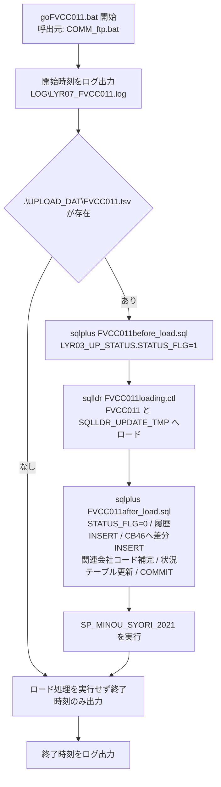

# 処理フロー

/// tab | 本文

## 1. 実行順序（ジョブネット）

本ファイル自身のソースコードから読み取れる `call` 関係のみ（起動時刻・周期はタスクスケジューラ由来のため書かない）。概要のみを示し、引数・接続先は[外部リクエスト仕様](goFVCC011_08_外部リクエスト仕様.md)を参照。

| 実行順 | 処理ID／プログラム名 | 区分 | 備考 |
| ------ | -------------------- | ---- | ---- |
| 1 | `COMM_ftp.bat` | 先行 | 共通バッチエンジン。`COMM_FTP_FVCC011.bat`（ラッパー）→ `COMM_ftp.bat` → 本バッチの順に `call` される。詳細は外部リクエスト仕様「5. 呼出元一覧」 |
| 2 | `goFVCC011.bat` | **本バッチ** | |
| 3 | （該当なし） | 後続 | 本バッチは他の `.bat` を `call` しない。`SP_MINOU_SYORI_2021` は DB(SQL) 処理のため本表の対象外（外部リクエスト仕様「3. 呼び出し一覧」） |

## 2. 処理フロー図

## 3. 処理ステップ（プロセス記述）

`No.` は上記フロー図のノードと対応する（旧「プロセス記述書」を本ページに統合）。

| No. | 処理内容                                                                                                    | 入力                                          | 出力                                                        | 備考 |
| --- | ------------------------------------------------------------------------------------------------------------ | --------------------------------------------- | -------------------------------------------------------------- | ---- |
| 1   | 開始時刻をログ出力する                                                                                         | －                                            | `LOG\LYR07_FVCC011.log`                                        | ファイル存在有無に関わらず必ず実行 |
| 2   | `.\UPLOAD_DAT\FVCC011.tsv`の存在を確認する                                                                     | ファイル存在                                  | －                                                              | 存在しなければNo.3〜7をスキップし、No.8（終了ログ）へ進む |
| 3   | `FVCC011before_load.sql`を実行し、更新ステータスを取込中（`'1'`）に更新する                                    | －                                            | `LYR03_UP_STATUS`（`TABLE_MEI='CBB8'`）                        | 更新条件表No.1参照 |
| 4   | SQL\*Loaderで`FVCC011.tsv`を`FVCC011`（明細）／`SQLLDR_UPDATE_TMP`（トレーラ）へロードする                     | `.\UPLOAD_DAT\FVCC011.tsv`                     | `FVCC011`／`SQLLDR_UPDATE_TMP`／`LOG\loading_011.log`          | ファイル入力仕様参照。更新条件表No.2・3参照 |
| 5   | `FVCC011after_load.sql`を実行し、ステータス復帰・取込履歴登録・`CB46`への差分反映・関連会社コード補完・古い状況の削除・新規状況の登録を行いコミットする | `FVCC011`／`SQLLDR_UPDATE_TMP`／`FVCF006`／`FVCF303` | `LYR03_UP_STATUS`／`SQLLDR_UPDATE_LOG`／`CB46`／`SQLLDR_UPDATE` | 更新条件表No.4〜10参照 |
| 6   | ストアドプロシージャー`SP_MINOU_SYORI_2021`を実行する                                                            | －                                            | （記入：プロシージャー内部のDB更新内容は本フォルダーの対象外。`db-sql-processing-spec`側での作成有無は要確認） | ソース上、旧バージョン`SP_MINOU_SYORI_2019`の呼出し行は`rem`でコメントアウトされており実行されない（コメント「未納処理呼込重複の対策 2021.09.22」より、`2021`版へ切替済みと判断） |
| 7   | 終了時刻をログ出力する                                                                                         | －                                            | `LOG\LYR07_FVCC011.log`                                        | No.2でファイル未存在と判定した場合もここは必ず実行される |

## 4. 補足

- ファイル未存在時はロード処理一式をスキップし、開始・終了時刻のログのみ出力する（エラーとしない）。
- 排他フラグ`goFVCC011.flg`の作成・削除は本ファイルではなく呼出元`COMM_ftp.bat`が行う
  （詳細は[COMM_ftp](<../[Sample]COMM_ftp/index.md>)参照）。
- `SP_MINOU_SYORI_2021`実行前に旧バージョン`SP_MINOU_SYORI_2019`の呼出し行が存在するが、
  ソース上`rem`でコメントアウトされており現在は実行されない（2021.09.22変更、詳細は
  上記「3. 処理ステップ（プロセス記述）」No.6 を参照）。

///

/// tab | 文書情報・改定履歴

## 文書情報

| 大分類 | 小分類 | ドキュメント名 | システムID | システム名 |
| ------ | ------ | -------------- | ---------- | ---------- |
| 8 | 8.2.3 | 処理フロー | AZR | 納期管理システム |

## 改定履歴

| Version | 計画書No. | 改訂日     | 改訂内容 | 担当者 | 課題No./備考 |
| ------- | --------- | ---------- | -------- | ------ | ------------ |
| 1.0.0 | K2603-A002 | 2026-09-29 | 新規作成 | KCCS(岡) | - |

///
