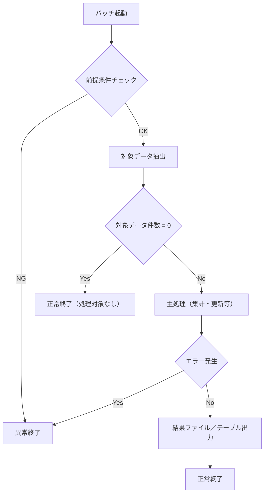

# 処理フロー

## 1. 実行順序（ジョブネット）

本ファイル自身のソースコードから読み取れる呼出し関係（本ファイルが他の`.bat`を`call`する、
または本ファイルが呼出元から`call`される等）のみを記載する。同一タスクから起動される他バッチ
との前後関係はWindowsタスクスケジューラの設定情報であり、本ファイルのソースコードには
含まれないため記載しない。呼出し関係が無ければ「該当なし」とする。

「実行順序（ジョブネット）」は、本バッチが `.bat` の連鎖のどこに位置するか（先行／本バッチ／後続）の**概要**だけを書く。対象は `.bat` のみで、API・DB(SQL) 処理は現れない。引数・接続先はここに書かず、後続の詳細は「外部リクエスト仕様」の「3. 呼び出し一覧」「4. 引数」、先行の詳細は同「5. 呼出元一覧」を参照する（二重管理しない）。

| 実行順   | 処理ID／プログラム名 | 区分         | 備考 |
| -------- | ---------------------- | ------------ | ---- |
| （記入） |                        | 先行         |      |
| （記入） |                        | **本バッチ** |      |
| （記入） |                        | 後続         |      |

## 2. 処理フロー図

## 3. 処理ステップ（プロセス記述）

処理ステップを起動から終了まで 1 行 1 ステップで記述する（旧「プロセス記述書」を本ページに統合）。`No.` は上記フロー図のノードと対応させる。

| No.      | 処理内容 | 入力 | 出力 | 備考 |
| -------- | -------- | ---- | ---- | ---- |
| （記入） |          |      |      |      |

## 4. 補足

- （記入）

---

## 文書情報

| 大分類 | 小分類 | ドキュメント名 | システムID | システム名 |
| ------ | ------ | -------------- | ---------- | ---------- |
| 8 | 8.2.3 | 処理フロー | （記入） | （記入） |

## 改定履歴

| Version | 計画書No. | 改訂日     | 改訂内容 | 担当者 | 課題No./備考 |
| ------- | --------- | ---------- | -------- | ------ | ------------ |
| 1.0.0 | K2603-A002 | 2026-09-29 | 新規作成 | KCCS(岡) | - |
