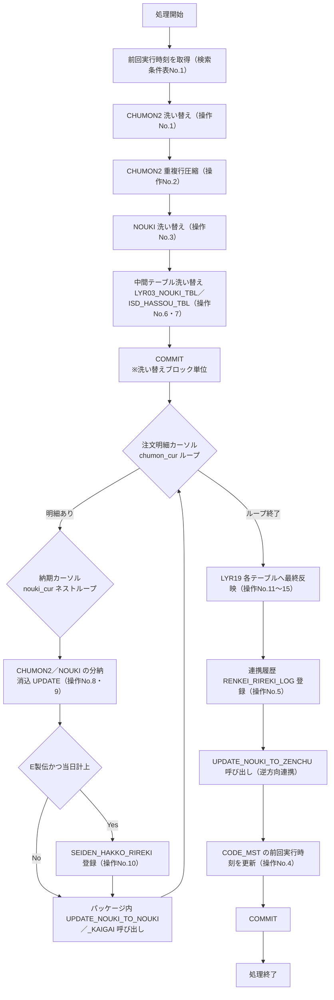

# 処理概要

/// tab | 本文

## 1. 基本情報

| 項目           | 内容                              |
| -------------- | ---------------------------------- |
| システムID     | AZR                                |
| DB(SQL)処理ID  | NOUKI_PKG                          |
| オブジェクト名 | `NOUKI_PKG.NOUKI_RENKEI`           |
| 作成日／作成者 | 不明（原設計書未受領のため未特定） |

## 2. 処理フロー図

DB更新箇所には[更新条件表](NOUKI_PKG_03_更新条件表.md)の操作No.を、DB検索箇所には
[検索条件表](NOUKI_PKG_04_検索条件表.md)の検索条件表No.を、コミット箇所は独立ノードとして併記する。

**【要確認】** ロールバック範囲・異常終了時の整合性が未調査のため、図中のCOMMIT位置は
「ステージングテーブル洗い替えごとにコミットする」というトランザクション方針
（[更新条件表](NOUKI_PKG_03_更新条件表.md)4.）から導いた想定位置であり、970行全体の`COMMIT`文の
出現位置を1件ずつ特定したものではない。

### 処理フロー概要（補足）

`NOUKI_RENKEI`は約970行の大きなプロシージャーであり、以下は主要ブロック単位の要約（逐行の詳細ではない）。
ローカル変数・カーソルを多数使用する手続き型の実装。詳細な処理ステップは3.を参照。

1. 前回実行時刻（`predatetime`）を共通設定マスター`CODE_MST`から取得し、現在時刻（`todaytime`）との
   区間を差分抽出条件として使う（チェックポイント方式、[更新条件表](NOUKI_PKG_03_更新条件表.md)操作No.4参照）。
2. ステージングテーブル`CHUMON2`／`NOUKI`を全洗い替えし、全注側の対象データを抽出する。
3. `LYR19`⇔`SCSALES`の中間テーブル群（`LYR03_NOUKI_TBL`／`ISD_HASSOU_TBL`等）を洗い替える。
4. 注文明細×納期データをカーソルでループし、客先要求・営業希望・製造回答・客先回答の4種納期を
   消込・分納管理する（処理の中核）。ループ内で同一パッケージ内の他プロシージャーを呼び出す。
5. `LYR19`側の各テーブルへ最終反映し、連携履歴（`RENKEI_RIREKI_LOG`）を記録する。
6. 納期管理→全注方向の逆連携プロシージャーを呼び出したのち、`CODE_MST`の前回実行時刻を更新する
   （更新は処理完了後の最後の1文。失敗時は更新されない設計 — 6.も参照）。

## 3. 処理ステップ（プロセス記述）

| No. | 処理内容                                                                 | 入力                                                              | 出力                                                    | 備考 |
| --- | --------------------------------------------------------------------------- | --------------------------------------------------------------------- | ----------------------------------------------------------- | ---- |
| 1   | 前回実行時刻（`predatetime`）を取得                                         | `CODE_MST`                                                             | ローカル変数`predatetime`                                    | チェックポイント方式。[更新条件表](NOUKI_PKG_03_更新条件表.md)操作No.4参照 |
| 2   | `CHUMON2`洗い替え・全注側の更新注文データ抽出                               | `AZSDB0.TAZSD001`／`TAZSD002`／`TAZSD007`、`AZIDB0.TAZIM001`           | `CHUMON2`                                                    | 更新条件表 操作No.1 |
| 3   | `CHUMON2`の重複行圧縮（同一注文No.・製伝No.の数量合算、重複行DELETE）        | `CHUMON2`（`chumon_cur`）                                              | `CHUMON2`                                                    | 更新条件表 操作No.2 |
| 4   | `NOUKI`洗い替え（`CHUMON2`該当分の全注納期データ抽出）                      | `AZSDB0.TAZSD003`、`CHUMON2`                                           | `NOUKI`                                                      | 更新条件表 操作No.3 |
| 5   | `LYR19`→`SCSALES`方向の中間テーブル洗い替え（`LYR03_NOUKI_TBL`／`ISD_HASSOU_TBL`） | `LYR19.LYR03_NOUKI_TBL`、`LYR19.JCHZN_TBL`等                          | `SCSALES.LYR03_NOUKI_TBL`、`SCSALES.ISD_HASSOU_TBL`          | 対象は`predatetime`〜`todaytime`の更新分＋`CHUMON2`該当分 |
| 6   | 注文明細×納期データの紐付けループ（`chumon_cur`×`nouki_cur`のネストカーソル） | `CHUMON2`、`NOUKI`（`nouki_cur`）                                      | `NOUKI`（4種納期数量の減算UPDATE）、`CHUMON2`（分納カウント等のUPDATE） | 分納ロジックの中核。[検索条件表](NOUKI_PKG_04_検索条件表.md)参照 |
| 7   | E製伝（区分01／02）の発行履歴登録                                            | `LYR19.JCHZN_TBL`                                                      | `SCSALES.SEIDEN_HAKKO_RIREKI`                                | E製伝かつ当日計上のみ（6のループ内） |
| 8   | `UPDATE_NOUKI_TO_NOUKI_KAIGAI`呼び出し（E製伝の場合）                        | 6の処理結果（`seidenNo`等）                                            | 同パッケージ内の別プロシージャーに処理委譲                     | パッケージ内呼び出し（6のループ内） |
| 9   | `UPDATE_NOUKI_TO_NOUKI`呼び出し（E製伝またはK製伝の場合）                    | 6の処理結果（`seidenNo`等）                                            | 同パッケージ内の別プロシージャーに処理委譲                     | パッケージ内呼び出し（6のループ内） |
| 10  | `LYR19.LYR03_NOUKI_TBL`への反映（定期取得分／FALCON55作成分／区分02連携分の3パターン） | `SCSALES.LYR03_NOUKI_TBL`、`SCSALES.LYR03_NOUKI_TMP`、`LYR19.LYR03_NOUKI_TMP` | `LYR19.LYR03_NOUKI_TBL`、`RENKEI_RIREKI_LOG`                 | 更新条件表参照 |
| 11  | `LYR19.MEMO_TBL`への反映（E製伝型代納期連携）                                | `SCSALES.MEMO_TMP`                                                     | `LYR19.MEMO_TBL`、`RENKEI_RIREKI_LOG`                        |      |
| 12  | `LYR19.LYR03_NOUKI_LOG`／`ISD_HASSOU_TBL`／`DSD_HASSOU_TBL`への反映         | `SCSALES`側の対応テーブル                                              | `LYR19`側の対応テーブル                                      |      |
| 13  | `UPDATE_NOUKI_TO_ZENCHU`呼び出し（納期管理→全注方向の逆連携）               | -                                                                       | 同パッケージ内の別プロシージャーに処理委譲                     | パッケージ内呼び出し |
| 14  | 前回実行時刻（`CD1`）を今回実行時刻（`todaytime`）で更新                    | -                                                                       | `CODE_MST`                                                   | 処理完了後・最後の1文として更新（途中で失敗した場合は更新されない対策。ソースコメントで明記） |

## 4. 呼び出す他オブジェクト

| No. | 呼び出し先オブジェクト                        | 呼び出し目的 |
| --- | ------------------------------------------------ | -------------- |
| 1   | `NOUKI_PKG.UPDATE_NOUKI_TO_NOUKI`（パッケージ内） | 全注SYS納期データを納期管理SYS納期データへ反映（E製伝またはK製伝、ループ内で製伝ごとに呼び出し） |
| 2   | `NOUKI_PKG.UPDATE_NOUKI_TO_NOUKI_KAIGAI`（パッケージ内） | 海外向けE製伝の納期データ反映（ループ内で条件に該当する製伝ごとに呼び出し） |
| 3   | `NOUKI_PKG.UPDATE_NOUKI_TO_ZENCHU`（パッケージ内） | 納期管理SYS→全注SYS方向の逆連携（メインループ完了後に1回呼び出し） |

※ いずれも同一パッケージ内の呼び出しのためパッケージ修飾なし（`UPDATE_NOUKI_TO_NOUKI(...)`等）で
記述されている。外部の別パッケージ／ファンクションへの呼び出しは確認できなかった。

## 5. 業務ルール・注意事項

- 本プロシージャーは全注文システム（`AZSDB0`／`AZIDB0`スキーマ）と納期管理システム（`LYR19`／`SCSALES`
  スキーマ）の**2つの異なるスキーマ間のデータ同期**を行う、いわばETL処理をPL/SQLで実装したもの。
  関与するテーブルは20以上に及ぶ（[更新条件表](NOUKI_PKG_03_更新条件表.md)参照）。
- トランザクション境界: 各ステージング／中間テーブルの洗い替えごとに`COMMIT`が発行されている
  （1トランザクション＝1ブロックではなく、ブロック単位で細かくコミットする実装）。
- 排他制御: [排他マトリクスの調査結果](<../../../05-システム設計書（全体）/[Sample]5-4_排他マトリクス.md>)の
  とおり、本システム全体に排他制御機構は存在しない。本プロシージャーも同時実行を防ぐ仕組み（アドバイザ
  リロック等）を持たない — タスクスケジューラ側で単純に「前回の実行が終わっていなければ実行しない」
  設定（`繰り返し:実行中の場合は停止`）に依存している可能性があるが、今回の調査範囲では確認できて
  いない（要確認）。

本ページは970行全体を網羅した完全な逐次仕様ではなく、主要な構造（チェックポイント方式・洗い替え
パターン・カーソルによる行圧縮・分納消込ロジック）を代表的に示すレベルにとどめている。個々の
UPDATE文の分岐条件（4種納期それぞれの消込ロジック等）の完全な仕様化は今後の課題。

## 6. 異常時の挙動・リトライ／リカバリ方針

### 終了コード／呼び出し元への通知

| 項目                   | 内容 |
| ---------------------- | ---- |
| 正常終了時の通知方法   | 戻り値なし（PROCEDURE）。呼び出し元`NOUKI_RENKEI.sql`はEXECUTE後、次の行へ進むのみで明示的な正常終了通知はしない。 |
| 異常終了時の通知方法   | 本プロシージャー自体にトップレベルの例外処理はない（[インターフェース仕様](NOUKI_PKG_01_インターフェース仕様.md)参照）。未捕捉のOracleエラーは呼び出し元SQL*Plusまで伝播する。 |
| 未捕捉例外発生時の挙動 | 呼び出し元`NOUKI_RENKEI.sql`の`WHENEVER SQLERROR EXIT SQL.SQLCODE`／`WHENEVER OSERROR EXIT FAILURE`により、SQL\*Plusプロセスが非0の終了コードで終了する。 |

### リトライ／通知方針

| 項目         | 内容 |
| ------------ | ---- |
| リトライ有無 | 呼び出し元バッチ`NOUKI_RENKEI.bat`を確認した範囲ではリトライ処理なし（1回実行のみ）。 |
| 通知手段     | `NOUKI_RENKEI.bat`は実行ログを`LOG\NOUKI_DATA_RENKEI_{年月日}.log`へ出力するのみ確認。メール通知等の仕組みは同バッチ内では確認できなかった（要確認）。また同バッチはsqlplus呼び出しの成功／失敗を判定せず、ウォッチドッグ用タイムスタンプファイル`DATA\renkei_wdt.dat`を無条件で更新している。外部の監視プロセスがこのファイルの更新時刻を監視している可能性があるが、当該監視の仕組み自体は本調査範囲外（要確認）。 |
| 通知条件     | 未調査（要確認）。 |

### リラン（再実行）／リカバリ

| 項目                             | 内容 |
| -------------------------------- | ---- |
| 再実行可否                       | 再実行可（ソース設計上の意図）。3.No.14「`CODE_MST`の前回実行時刻更新」は処理完了後の最後の1文であり、途中で異常終了した場合はこの更新が実行されないよう意図的に配置されている（ソースコメント「処理完了後に前回開始時刻を更新するように変更（それまでに失敗した場合、更新されないようにする対策）」で明記）。 |
| 再実行時の前提条件               | 特になし（チェックポイントが進まないため、次回実行時は同じ`predatetime`〜新しい`todaytime`の区間で再抽出される）。ただし`CHUMON2`／`NOUKI`以外の中間テーブル（`SCSALES.LYR03_NOUKI_TMP`等）やパッケージ内呼び出し先（`UPDATE_NOUKI_TO_NOUKI`等）側の再実行時の冪等性までは未調査（要確認）。 |
| 処理途中で異常終了した場合の影響 | [更新条件表](NOUKI_PKG_03_更新条件表.md)の「トランザクション方針」も参照。ステージング／中間テーブル単位で細かく`COMMIT`されるため、途中終了時は一部のテーブルのみ更新された状態で残る可能性がある。ただしチェックポイント（`CODE_MST`）自体は進まないため、次回実行時に同じ区間が再抽出され、洗い替え対象のテーブルは上書きされる。 |
| リカバリ手順                     | ソース上は「再実行するだけでよい」設計に見えるが、確定的な運用手順（マニュアル等）は未調査（要確認）。 |

///

/// tab | 文書情報・改定履歴

## 文書情報

| 大分類 | 小分類 | ドキュメント名 | システムID | システム名 |
| ------ | ------ | -------------- | ---------- | ---------- |
| 8 | 8.3.3 | 処理概要 | AZR | 納期管理システム |

## 改定履歴

| Version | 計画書No. | 改訂日     | 改訂内容 | 担当者 | 課題No./備考 |
| ------- | --------- | ---------- | -------- | ------ | ------------ |
| 1.0.0 | K2603-A002 | 2026-09-29 | 新規作成 | KCCS(岡) | - |

///
