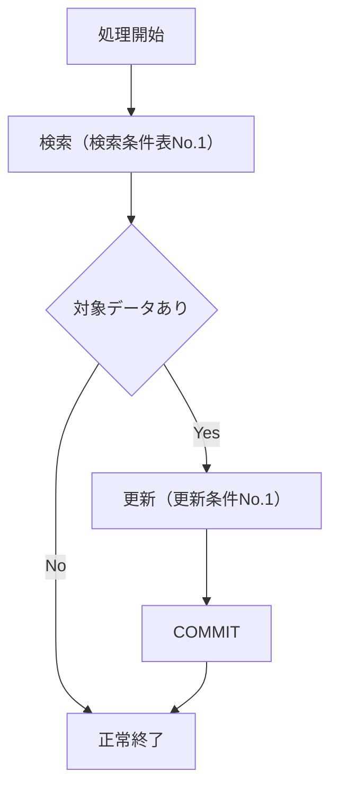

# 処理概要

## 1. 基本情報

| 項目           | 内容 |
| -------------- | ---- |
| システムID     | （記入） |
| DB(SQL)処理ID  | {package-id} |
| オブジェクト名 | （記入） |
| 作成日／作成者 | （記入） |

## 2. 処理フロー図

### 処理フロー概要（補足）

（記入。図だけでは表現しきれない前提・制約を箇条書きで記載する。無い場合は本節を削除する）

## 3. 処理ステップ（プロセス記述）

| No.      | 処理内容 | 入力 | 出力 | 備考 |
| -------- | -------- | ---- | ---- | ---- |
| （記入） |          |      |      |      |

## 4. 呼び出す他オブジェクト

| No.      | 呼び出し先オブジェクト | 呼び出し目的 |
| -------- | ------------------------ | -------------- |
| （記入） |                          |                |

## 5. 業務ルール・注意事項

（記入）

## 6. 異常時の挙動・リトライ／リカバリ方針

### 終了コード／呼び出し元への通知

| 項目                   | 内容 |
| ---------------------- | ---- |
| 正常終了時の通知方法   | （記入。例：OUT引数の戻り値、RAISEしない、等） |
| 異常終了時の通知方法   | （記入。例：例外をRAISEして呼び出し元に伝播、呼び出し元のSQLCODEで検知、等） |
| 未捕捉例外発生時の挙動 | （記入。例：呼び出し元の`WHENEVER SQLERROR`等に依存、呼び出し元のトランザクションはロールバックされる、等） |

### リトライ／通知方針

| 項目         | 内容 |
| ------------ | ---- |
| リトライ有無 | （記入。回数・間隔。オブジェクト自身がリトライするか、呼び出し元に委ねるか） |
| 通知手段     | （記入） |
| 通知条件     | （記入） |

### リラン（再実行）／リカバリ

| 項目                             | 内容 |
| -------------------------------- | ---- |
| 再実行可否                       | （記入） |
| 再実行時の前提条件               | （記入。事前の削除・戻しが必要なデータ等） |
| 処理途中で異常終了した場合の影響 | （記入。中間テーブル／ステージングテーブルが中途半端な状態で残るか等） |
| リカバリ手順                     | （記入） |

---

## 文書情報

| 大分類 | 小分類 | ドキュメント名 | システムID | システム名 |
| ------ | ------ | -------------- | ---------- | ---------- |
| 8 | 8.3.3 | 処理概要 | （記入） | （記入） |

## 改定履歴

| Version | 計画書No. | 改訂日     | 改訂内容 | 担当者 | 課題No./備考 |
| ------- | --------- | ---------- | -------- | ------ | ------------ |
| 1.0.0 | K2603-A002 | 2026-09-29 | 新規作成 | KCCS(岡) | - |
