# タイムチャート — サンプル（実データ）

*空テンプレートは [空テンプレート](<[Template]9-2_タイムチャート.md>)、書き方は [使い方](<[使い方]9-2_タイムチャート.md>) を参照。
本サンプルは **Windows タスクスケジューラ一覧（2026-07-23 取得、`src/reference/タスクスケジューラ一覧_納期管理_20260723.xlsx`）の全 27 タスク**を記載した実データ。
スケジュールの正は [2. 起動スケジュール一覧](#sec2)。[1](#sec1) は節2 から起こしたビュー。*

*実行環境：AP サーバー `KYTSCHQNTS13`（本社内製システム共用。[10.2 機器構成一覧](<../../10-インフラ設計/10-2_機器構成一覧/[Sample]10-2_機器構成一覧.md>) 参照）の Windows タスクスケジューラ。全 27 タスクが同一ホストに登録（ユーザー確認 2026-09-09）。*

| 節 | 内容 | 見たいとき |
| -- | ---- | ---------- |
| [1. タイムチャート（日次・俯瞰）](#sec1) | 1 日の帯チャート | 時間帯の混み具合 |
| [2. 起動スケジュール一覧](#sec2) | 系統別（A〜E）。タスクごとの周期・時刻・起動するバッチ（**正**） | 正確な時刻・実行順 |
| [3. 特記事項](#sec3) | 実行順序・時刻の背景（※1〜※4） | なぜその順序・時刻か |

## 1. タイムチャート（日次・俯瞰）

```mermaid
%%{init: {"gantt": {"topAxis": true}}}%%
gantt
  title 日次タイムチャート（俯瞰。月次のみのタスクは除く。正確な時刻は節2）
  dateFormat HH:mm
  axisFormat %H:%M
  section A. 全注→納期管理 データ連携（FTP／SP）
  No.1 受注残の更新 :t1_1, 01:35, 30m
  No.3 実績（FVCxx）① :t3_1, 17:25, 30m
  No.3 実績（FVCxx）② :t3_2, 18:01, 25m
  No.3 実績（FVCxx）③ :t3_3, 19:00, 50m
  No.3 実績（FVCxx）④ :t3_4, 20:00, 60m
  No.3 実績（FVCxx）⑤ :t3_5, 22:10, 60m
  No.4 出荷指示① :t4_1, 06:40, 20m
  No.4 出荷指示② :t4_2, 16:02, 20m
  No.5 送付先マスタ（日次） :t5_1, 22:30, 30m
  No.6 取引先マスタ（日次） :t6_1, 23:10, 30m
  section B. Web API 連携（受注WF／SR判定）
  No.8 受注WF① :t8_1, 08:34, 240m
  No.8 受注WF② :t8_2, 13:29, 180m
  No.8 受注WF③ :t8_3, 16:44, 120m
  No.9 SR判定（AM）① :t9_1, 07:40, 330m
  No.9 SR判定（AM）② :t9_2, 12:50, 30m
  No.10 SR判定（PM）① :t10_1, 13:25, 30m
  No.10 SR判定（PM）② :t10_2, 13:40, 360m
  No.10 SR判定（PM）③ :t10_3, 14:00, 30m
  section C. KGSS・海外INV（curl）／事業部実績
  No.11 KGSS受注残 :t11_1, 08:40, 30m
  No.12 KGSS売上実績 :t12_1, 08:45, 30m
  No.13 KGSS生産実績① :t13_1, 14:35, 30m
  No.13 KGSS生産実績② :t13_2, 17:25, 30m
  No.14 KGSS-CB52 :t14_1, 17:35, 30m
  No.15 KAIGAI出荷指示 :t15_1, 16:00, 180m
  No.16 仮生産実績連携① :t16_1, 13:00, 60m
  No.16 仮生産実績連携② :t16_2, 16:00, 60m
  No.16 仮生産実績連携③ :t16_3, 18:00, 60m
  section D. 全注_納期データ連携（全注側フォルダー）
  No.17 納期データ連携 8〜12時 :t17_1, 08:42, 270m
  No.18 納期データ連携 13〜16時 :t18_1, 13:37, 224m
  No.19 納期データ連携 17〜20時 :t19_1, 17:23, 270m
  No.21 全見込データ消込 :t21_1, 23:00, 30m
  No.22 納期データ連携監視 :t22_1, 08:57, 780m
  section E. 運用・監視
  No.23 稼働日チェック :t23_1, 00:05, 30m
  No.24 LYR19データ連携チェック :t24_1, 08:00, 30m
  No.25 データバックアップ① :t25_1, 12:20, 30m
  No.25 データバックアップ② :t25_2, 17:00, 30m
  No.26 テストデータ作成 :t26_1, 04:00, 30m
  No.27 ボタン押下ログ :t27_1, 03:00, 30m
```

*※帯はトリガーごとに 1 本（繰り返し設定があるトリガーは初回〜最終回の期間、無いものは 30 分の目安幅）。ラベル＝節2 の No.＋短い名前＋起動回（①②…は節2 の「実行時刻（トリガー）」の番号と同じ。トリガーが 1 つのタスクは番号なし）。正確な時刻は [節2](#sec2)。オンライン運用時間の帯は [9.1 運用方針](<../9-1_運用方針/[Template]9-1_運用方針.md>) 節3「運用時間」の確定後に追加する（運用時間の正は 9.1）。*

## 2. 起動スケジュール一覧

*スケジューラに登録された起動単位（タスク）ごとに 1 行。表は系統（[節1](#sec1) の帯と同じ A〜E）ごとに分け、No. は全体の通し番号。出典：タスクスケジューラ一覧（2026-07-23 取得）。*

*凡例：**①②…＝1 日の起動回（トリガー）、1. 2.…＝各起動回で上から順に実行するバッチ**（どの回でも全件を順に実行する。番号は 2 件以上のときだけ付ける）。周期は 日次／週次／月次／年次／随時／不明。「処理の目的」はタスク単位の 1 文（何を取り込み、何を更新するか。ソースで確認できない部分は「要確認」。詳細は各バッチの 8.2）。「起動するバッチ」はスケジューラが実際に起動するファイル名（定義は [6.3 バッチ一覧](<../../06-システム設計書（一覧、管理台帳）/6-3_バッチ一覧/[Sample]6-3_バッチ一覧.md>)。同じバッチを起動するタスクはこの列を検索して探す）。「時刻の根拠」は一覧のコメント欄・概要欄から転記し、無いものは「不明（要確認）」。特記の ※ は [節3](#sec3) へ。*

*注意：スケジューラ上のフォルダー・実行ファイルの場所・作業フォルダーはスケジューラ一覧（INPUT）を参照し本書には転記しない。タスク名の半角カナは全角に直して記載している（登録名の原文：`全注_全見込ﾃﾞｰﾀ作成`、`全注_全見込ﾃﾞｰﾀ消込処理`）。*

### 2-A. 全注→納期管理 データ連携（FTP／SP）

| No. | 起動タスク名 | 処理の目的 | 周期・実行日 | 実行時刻（トリガー） | 起動するバッチ（実行順） | 時刻の根拠 | 特記 |
| --- | ------------ | ---------- | ------------ | -------------------- | ------------------------ | ---------- | ---- |
| 1 | 納期管理_受注残の更新 | 全注文システムから FTP で受注残・分納データ FVCF006 を取り込み、分納情報を反映して受注残テーブル（`JCHZN_TBL`）を日次更新し、続けて国内製伝の集計コードを受注残へ反映する（`SP_JCHZN_TBL_KOKUNAI`） | 日次・毎日 | 01:35 | 1. `COMM_FTP_FVCF006` 2. `SP_JCHZN_TBL_KOKUNAI` | 連携元の日次締めの後（一覧コメント「本来は 1:35。仮で 5:00 に設定」＝現在の登録は 01:35） | [※1](#note-1) |
| 2 | 納期管理_受注残(月次)の更新 | 全注文システムから FTP で受注残データ FVCF303 を取り込み、受注残テーブル（`JCHZN_TBL`）を月初に再構築する。あわせて分納・納期回答の状態を更新し、完納済み注残と納期関連テーブルの履歴を保存する | 月次・毎月1日 | 01:05 | `COMM_FTP_FVCF303` | 月初の受注残再構築。日次（01:35）より先に完了させる | [※1](#note-1) |
| 3 | 納期管理_実績（FVCxx）の更新 | 全注文システムから FTP で受注実績・生産実績・売上実績・社内発注・社内生産の実績データ（FVCC007〜015＝`CB41`/`CBB5`・`CB42`・`CB52`・`CB45`・`CB46`・`CB0F`・`CBD5`）を取り込み、実績テーブルを追記更新する。FVCC011 では未納処理（出荷指示・FLT 納期へのマイナス反映）も行う（CB 表と業務名の対応は要確認） | 日次・毎日 | ①17:25 ②18:01 から 20m間隔で25m ③19:00 から 20m間隔で50m ④20:00 から 30m間隔で1h ⑤22:10 から 30m間隔で1h | 1. `COMM_FTP_FVCC007` 2. `COMM_FTP_FVCC008` 3. `COMM_FTP_FVCC009` 4. `COMM_FTP_FVCC010` 5. [`COMM_FTP_FVCC011`](<../../08-システム機能設計書/8-2_バッチ処理定義書/[Sample]COMM_FTP_FVCC011/index.md>) 6. `COMM_FTP_FVCC015` 7. `COMM_FTP_FVCC014` | 製造側の実績確定に追随して夕方〜夜間に 5 回取り込む（各回の根拠は要確認） | [※2](#note-2) |
| 4 | 納期管理_出荷指示の更新 | 全注文システムから FTP で確定した出荷指示（海外）FVAAD13 を取り込み、出荷指示マスタ（`SHUKKA_SHIJI_MST`）を更新する | 日次・月〜土 | ①06:40 から 5m間隔で20m ②16:02 から 5m間隔で20m | `COMM_FTP_FVAAD13` | 不明（要確認） |  |
| 5 | 納期管理_送付先マスタの更新（日次) | 全注文システムから FTP で送付先マスタ FVKRD21（全件）・FVKRD22（差分）を取り込み、送付先マスタ（`FVKRD21_MST`）を全件入替のうえ差分を反映する | 日次・月〜土 | 22:30 | 1. `COMM_FTP_FVKRD21` 2. `COMM_FTP_FVKRD22` | 不明（要確認） |  |
| 6 | 納期管理_取引先マスタの更新（日次） | 全注文システムから FTP で取引先マスタ FVKRD69 を取り込み、取引先マスタ（`TORIHIKISAKI_MST`）を入れ替える | 日次・毎日 | 23:10 | `COMM_FTP_FVKRD69` | 不明（要確認） |  |
| 7 | 納期管理_取引先マスタの更新（月次） | 全注文システムから FTP で取引先マスタ FVKRD69 を取り込み、取引先マスタ（`TORIHIKISAKI_MST`）を月初に入れ替える（日次 No.6 との使い分けは要確認） | 月次・毎月1日 | 07:00 | `COMM_FTP_FVKRD69` | 不明（要確認） |  |

### 2-B. Web API 連携（受注WF／SR判定）

| No. | 起動タスク名 | 処理の目的 | 周期・実行日 | 実行時刻（トリガー） | 起動するバッチ（実行順） | 時刻の根拠 | 特記 |
| --- | ------------ | ---------- | ------------ | -------------------- | ------------------------ | ---------- | ---- |
| 8 | 納期管理_受注WFの更新 | Web API から受注ワークフローの速報データ VDRAD003・VDRAD004・VDRAM004 を取得して取り込み、受注速報の確定分・下書き分を受注残へ反映し、製伝変更ログと納期の自動回答を更新する | 日次・毎日 | ①08:34 から 30m間隔で4h ②13:29 から 15m間隔で3h ③16:44 から 15m間隔で2h | 1. `WebApi_Service.wsf VDRAD003 1` 2. `WebApi_Service.wsf VDRAD004 1` 3. `WebApi_Service.wsf VDRAM004` | 不明（要確認） |  |
| 9 | SR判定の更新（AM） | Web API から出荷指示速報（海外）VDRAM001 と KCAF の出荷指示・SR 判定 VDRGD005・VDRGD007 を取得して取り込み、出荷指示マスタ（`SHUKKA_SHIJI_MST`）と `KCAF01` を更新し、SR 判定結果（STOP 判定・AT 区分）を出荷予定（`LYR03_EXP_TBL`）へ反映する | 日次・毎日 | ①07:40 から 30m間隔で5h30m ②12:50 | 1. `WebApi_Service.wsf VDRAM001` 2. `WebApi_Service.wsf VDRGD005 1` 3. `WebApi_Service.wsf VDRGD007 1` | 不明（要確認） |  |
| 10 | SR判定の更新（PM） | Web API から出荷指示速報（海外）VDRAM001 と KCAF の出荷指示・SR 判定 VDRGD005・VDRGD007 を取得して取り込み（AM の No.9 と同じ内容）、続けて R 判定になった分納の実着日を納入実績へ転記する（`SP_UPDATE_NOUNYU_JISSEKI`） | 日次・毎日 | ①13:25 ②13:40 から 30m間隔で6h ③14:00 | 1. `WebApi_Service.wsf VDRAM001` 2. `WebApi_Service.wsf VDRGD005 1` 3. `WebApi_Service.wsf VDRGD007 1` 4. `SP_UPDATE_NOUNYU_JISSEKI` | 午後に確定した SR 判定の実着日を納入実績として更新（一覧コメント） | [※4](#note-4) |

### 2-C. KGSS・海外INV（curl）／事業部実績

| No. | 起動タスク名 | 処理の目的 | 周期・実行日 | 実行時刻（トリガー） | 起動するバッチ（実行順） | 時刻の根拠 | 特記 |
| --- | ------------ | ---------- | ------------ | -------------------- | ------------------------ | ---------- | ---- |
| 11 | 納期管理_KGSS受注残更新 | 社内 API（`/scsales/api/kgss?obj=juchzn`）から KGSS の受注残を取得して取り込み、受注残テーブル（`JCHZN_TBL`）の該当製伝を更新する | 日次・毎日 | 08:40 | `kgss_juchuzan` | 不明（要確認） |  |
| 12 | 納期管理_KGSS売上実績更新 | 社内 API（`/scsales/api/kgss?obj=uriage`）から KGSS の売上実績を取得して取り込み、売上実績テーブル（`KGSS_URIAGE`）へ追記する | 日次・毎日 | 08:45 | `kgss_uriage` | 不明（要確認） |  |
| 13 | 納期管理_KGSS生産実績更新 | 社内 API（`/scsales/api/kgss?obj=seisan`）から KGSS の生産実績を取得して取り込み、生産実績テーブル（`KGSS_SEISAN`）へ追記のうえ、本日生産分を出荷予定（`LYR03_EXP_TBL`）へ登録する | 日次・毎日 | ①14:35 ②17:25 | `kgss_seisan` | 不明（要確認） |  |
| 14 | 納期管理_KGSS-CB52更新 | KGSS 受注残にある製伝の生産実績を、全注文システム側の生産実績（`CB52`）取込の後に KVC 直送分として出荷予定へ反映する（`LYR19_SEISAN_UP_KVC.sql`） | 日次・月〜土 | 17:35 | `kgss_seisan_up_cb52` | 全注文システム側の生産実績（`CB52`）取込（17:15〜18:00）の後に実行する（`LYR19_SEISAN_UP_KVC.sql` のコメント）。No.3 の FVCC009（17:25）の後 |  |
| 15 | 納期管理_KAIGAI出荷指示更新 | 社内 API（`/scsales/api/kgss?obj=kaigai`）から海外 INV の出荷指示を取得して取り込み、出荷指示 No. を KVC 採番に振り替えて当日更新分を出荷指示マスタ（`SHUKKA_SHIJI_MST`）へ反映する（分納 No. を付与） | 日次・毎日 | 16:00 から 30m間隔で3h | `kaigaiinv_shukkashiji` | 不明（要確認） |  |
| 16 | 仮生産実績連携 | 事業部が FTP サーバーへアップロードした当日の生産実績ファイルの最新版を取得し、精算更新として出荷予定（`LYR03_EXP_TBL`）を受注残から補完して更新する（詳細は要確認） | 日次・毎日 | ①13:00 から 15m間隔で1h ②16:00 から 15m間隔で1h ③18:00 から 15m間隔で1h | `SeisanUpdate_new` | FTP サーバーに事業部からアップロードされる当日生産実績を取り込む（一覧コメント） |  |

### 2-D. 全注_納期データ連携（全注側フォルダー）

| No. | 起動タスク名 | 処理の目的 | 周期・実行日 | 実行時刻（トリガー） | 起動するバッチ（実行順） | 時刻の根拠 | 特記 |
| --- | ------------ | ---------- | ------------ | -------------------- | ------------------------ | ---------- | ---- |
| 17 | 全注_納期データ連携(8～12時) | 全注文システム側の DB で、見込データ（`MIKOMI_PKG.MIKOMI_RENKEI`）→ 納期データ（`NOUKI_PKG.NOUKI_RENKEI`）→ 社内製伝の納期データ（`NOUKI_SHANAI_PKG`）を全注→納期管理の方向に連携し、最後にログのエラー有無を確認してメール通知する（`LogFileCheck`）。8〜12 時帯を 15 分間隔で実行し、監視用の時刻ファイル `renkei_wdt.dat` を更新する | 日次・毎日 | 08:42 から 15m間隔で4h30m | 1. `MIKOMI_RENKEI` 2. `NOUKI_RENKEI` 3. `SHANAI_RENKEI` 4. `LogFileCheck` （各バッチは `undisplay.vbs` 経由で起動） | 不明（要確認） |  |
| 18 | 全注_納期データ連携(13～16時) | 全注文システム側の DB で、見込データ（`MIKOMI_PKG.MIKOMI_RENKEI`）→ 納期データ（`NOUKI_PKG.NOUKI_RENKEI`）→ 社内製伝の納期データ（`NOUKI_SHANAI_PKG`）を全注→納期管理の方向に連携し、最後にログのエラー有無を確認してメール通知する（`LogFileCheck`）。13〜16 時帯を 15 分間隔で実行し、監視用の時刻ファイル `renkei_wdt.dat` を更新する | 日次・毎日 | 13:37 から 15m間隔で3h44m | 1. `MIKOMI_RENKEI` 2. `NOUKI_RENKEI` 3. `SHANAI_RENKEI` 4. `LogFileCheck` （各バッチは `undisplay.vbs` 経由で起動） | 不明（要確認） |  |
| 19 | 全注_納期データ連携(17～20時) | 全注文システム側の DB で、見込データ（`MIKOMI_PKG.MIKOMI_RENKEI`）→ 納期データ（`NOUKI_PKG.NOUKI_RENKEI`）→ 社内製伝の納期データ（`NOUKI_SHANAI_PKG`）を全注→納期管理の方向に連携し、最後にログのエラー有無を確認してメール通知する（`LogFileCheck`）。17〜20 時帯を 30 分間隔で実行し、監視用の時刻ファイル `renkei_wdt.dat` を更新する | 日次・毎日 | 17:23 から 30m間隔で4h30m | 1. `MIKOMI_RENKEI` 2. `NOUKI_RENKEI` 3. `SHANAI_RENKEI` 4. `LogFileCheck` （各バッチは `undisplay.vbs` 経由で起動） | 不明（要確認） |  |
| 20 | 全注_全見込データ作成 | 全注文システムの全発行見込を対象に、見込データを洗い替えで作り直す（`MIKOMI_PKG.MIKOMI_RENKEI_ALL`）。受注残テーブル（`JCHZN_TBL`）が月次でクリアされるため月初朝一に実行する | 月次・毎月1日 | 07:00 | `MIKOMI_RENKEI_ALL①` | `JCHZN_TBL` が月次でクリアされるため、月初朝一に作り直す（一覧コメント） | [※3](#note-3) |
| 21 | 全注_全見込データ消込処理 | 全注文システムの全発行見込を対象に見込データを作り直したうえで（`MIKOMI_PKG.MIKOMI_RENKEI_ALL`）、全注側で削除・発行済みとなり連携されなくなった見込（`JCHZN_TBL`・`MEMO_TBL`・`LYR03_NOUKI_TBL`）を消し込む（`SP_SCSALES_KESHIKOMI`） | 日次・毎日 | 23:00 | 1. `MIKOMI_RENKEI_ALL①` 2. `LYR19_KESHIKOMI③` | 夜間に、未発行が 0 になった `JCHZN_TBL`・`MIKOMI_TBL` を消し込む（一覧コメント） | [※3](#note-3) |
| 22 | 全注_納期データ連携監視 | No.17〜19 の連携バッチが更新する時刻ファイル `renkei_wdt.dat` の更新時刻と現在時刻の差を確認し、納期データ連携が止まっていないか監視する（VBScript。停止を検知したときの動作は要確認） | 日次・毎日 | 08:57 から 15m間隔で13h | `renkei_wdt.vbs` | 不明（要確認） |  |

### 2-E. 運用・監視

| No. | 起動タスク名 | 処理の目的 | 周期・実行日 | 実行時刻（トリガー） | 起動するバッチ（実行順） | 時刻の根拠 | 特記 |
| --- | ------------ | ---------- | ------------ | -------------------- | ------------------------ | ---------- | ---- |
| 23 | 納期管理_稼働日チェック | 当日が稼働日かを判定して稼働日ファイル `kadobicheck.txt` を更新し、社内 API（`/scsales/api/remote`）へ通知する（Java ツール `KadobiCheck`。判定元は要確認） | 日次・毎日 | 00:05 | `kadobicheck` | 日付切替直後（00:05）に実行。他タスクの稼働日判定の前提と推定（要確認） |  |
| 24 | 納期管理_LYR19データ連携チェック | 連携データの件数・更新日時を記録し（`SP_UPDATE_RENKEI_CHECKER` → `DATA_RENKEI_CHECKER`）、Java クライアントで全注との齟齬比較（`LYR19_DATA_RENKEI_CHECKER`）と社内製伝の更新（`SHANAI_SEIDEN_UPDATE`）を Excel 定義に基づいて実行する（詳細は要確認） | 日次・毎日 | 08:00 | 1. `LYR19_UPDATE_DATA_RENKEI_CHECKER` 2. `LYR19_DATA_RENKEI_CHECKER` 3. `SHANAI_SEIDEN_UPDATE` | 不明（要確認） |  |
| 25 | 納期管理_データバックアップ（オンライン） | 納期回答関連の 6 テーブル（`LYR03_TBL`・`LYR03_NOUKI_TBL`・`ISD_HASSOU_TBL`・`ONFLT_TBL`・`MEMO_TBL`・`DSD_HASSOU_TBL`）をファイルへバックアップする（`DB_BKUP.sql`） | 日次・毎日 | ①12:20 ②17:00 | `DB_BKUP` | 昼休みと終業時の 2 回（納期回答のバックアップ）。時刻の根拠は要確認 |  |
| 26 | テストデータ作成(日次) | 本番スキーマ `LYR19` の受注残（`JCHZN_TBL`）と関連テーブルを検証用スキーマ `LYR_TEST` へ同期する（`sync_table_from_lyr_test.sql`） | 日次・毎日 | 04:00 | `run_sync` | 不明（要確認） |  |
| 27 | ボタン押下ログ定期アップロード | 前日の Web アプリのログからボタン押下ログを抽出して CSV 化し、`LYR19.BUTTON_LOG` へ一括登録する（`uploadButtonLog.py`） | 日次・毎日 | 03:00 | `uploadButtonLog` | 前日のログファイルからボタン押下ログを抽出して DB へ登録（一覧コメント） |  |

## 3. 特記事項（運用ロジック）

*系統をまたぐ実行順序・時刻の背景（なぜその順序・時刻か）を 1 件＝1 小節で書き、[節2](#sec2) の「特記」列から ※番号で参照する。タスク → バッチの対応は節2 の「起動するバッチ」列、タスク間の関係は各 ※ の本文で示す。*

### ※1 月初は受注残（月次）の再構築を日次更新より先に実行する

*毎月 1 日は [No.2](#task-2)（01:05）で受注残を再構築し、その後 [No.1](#task-1)（01:35）で日次分を取り込む。No.1 の一覧コメントに「本来は 1:35。仮で 5:00 に設定」とあるが、2026-07-23 時点の登録は 01:35。現在の設定意図を要確認。*

### ※2 実績（FVCxx）の更新を 1 日 5 回に分ける

*[No.3](#task-3) は 17:25 の初回のほか 18:01／19:00／20:00／22:10 に繰り返し実行し、7 本の FTP 取込（`COMM_FTP_FVCC007`〜`COMM_FTP_FVCC015`）を毎回順に起動する。回数と時刻の根拠（製造側の実績確定タイミング）は要確認。*

### ※3 全見込データは月初に作り直し、夜間に消し込む

*`JCHZN_TBL` が月次でクリアされるため、毎月 1 日 07:00 に `MIKOMI_RENKEI_ALL①` で全見込データを作り直す（[No.20](#task-20)）。毎日 23:00 には同じバッチに続けて `LYR19_KESHIKOMI③` を実行し、未発行が 0 になった `JCHZN_TBL`・`MIKOMI_TBL` を消し込む（[No.21](#task-21)）。*

### ※4 SR 判定（PM）では納入実績の転記まで行う

*午後のタスク（[No.10](#task-10)）は AM（[No.9](#task-9)）と同じ 3 本の Web API 取込に加え、最後に `SP_UPDATE_NOUNYU_JISSEKI` を実行し、R 判定になった分納の実着日を納入実績へ転記する。*

---

## 文書情報

| 大分類 | 小分類 | ドキュメント名 | システムID | システム名 |
| ------ | ------ | -------------- | ---------- | ---------- |
| 9 | 9.2 | タイムチャート | AZR | 納期管理システム |

## 改定履歴

| Version | 計画書No. | 改訂日     | 改訂内容 | 担当者 | 課題No./備考 |
| ------- | --------- | ---------- | -------- | ------ | ------------ |
| 1.0.0 | K2603-A002 | 2026-09-29 | 新規作成 | KCCS(岡) | - |
