# タイムチャート

*記入用の空テンプレート。書き方は [使い方](<[使い方]9-2_タイムチャート.md>)、記入例は [サンプル](<[Sample]9-2_タイムチャート.md>) を参照。
スケジュールの正は「2. 起動スケジュール一覧」。節1 は節2 から起こすビューで、時刻・回数の正ではない。*

*実行環境：（スケジューラの種類とホスト名を記入。例：Windows タスクスケジューラ／`ホスト名`）*

## 1. タイムチャート（日次・俯瞰）

```mermaid
%%{init: {"gantt": {"topAxis": true}}}%%
gantt
  title 日次タイムチャート（俯瞰。月次のみのタスクは除く。正確な時刻は節2）
  dateFormat HH:mm
  axisFormat %H:%M
  section （系統名を記入）
  No.1 （短い名前）① :t1_1, 00:00, 30m
  No.1 （短い名前）② :t1_2, 12:00, 30m
  No.2 （短い名前） :t2_1, 06:00, 30m
```

*※帯はトリガーごとに 1 本（繰り返し設定があるトリガーは初回〜最終回の期間、無いものは 30 分の目安幅）。ラベル＝節2 の No.＋短い名前＋起動回（①②…は節2 のトリガー番号と同じ。トリガーが 1 つなら番号なし）。月次以下の周期のタスクは節1 には描かない。オンライン運用時間の帯を描く場合は [9.1 運用方針](<../9-1_運用方針/[Template]9-1_運用方針.md>) 節3「運用時間」の値を転記する（運用時間の正は 9.1）。*

## 2. 起動スケジュール一覧

*スケジューラに登録された起動単位（タスク）ごとに 1 行。表は系統（節1 の帯と同じ）ごとに分け、No. は全体の通し番号。出典：（スケジューラ一覧の取得日を記入）。*

*凡例：①②…＝1 日の起動回（トリガー）、1. 2.…＝各起動回で上から順に実行するバッチ（番号は 2 件以上のときだけ付ける）。周期は 日次／週次／月次／年次／随時／不明。「処理の目的」はタスク単位の 1 文（何を取り込み、何を更新するか）。*

### 2-A. （系統名を記入）

| No. | 起動タスク名 | 処理の目的 | 周期・実行日 | 実行時刻（トリガー） | 起動するバッチ（実行順） | 時刻の根拠 | 特記 |
| --- | ------------ | ---------- | ------------ | -------------------- | ------------------------ | ---------- | ---- |
| 1 | （記入） | （記入：何を取り込み、何を更新するかを 1 文で） | 日次・毎日 | ①（記入） ②（記入） | 1. `（バッチファイル名）` 2. `（バッチファイル名）` | （記入） |  |
| 2 | （記入） | （記入：何を取り込み、何を更新するかを 1 文で） | 日次・（曜日を列挙） | （記入） | `（バッチファイル名）` | （記入） |  |

### 2-B. （系統名を記入）

| No. | 起動タスク名 | 処理の目的 | 周期・実行日 | 実行時刻（トリガー） | 起動するバッチ（実行順） | 時刻の根拠 | 特記 |
| --- | ------------ | ---------- | ------------ | -------------------- | ------------------------ | ---------- | ---- |
| 3 | （記入） | （記入：何を取り込み、何を更新するかを 1 文で） | 月次・毎月（日付）日 | （記入） | `（バッチファイル名）` | （記入） |  |

## 3. 特記事項（運用ロジック）

*系統をまたぐ実行順序・時刻の背景（なぜその順序・時刻か）を 1 件＝1 小節で書き、節2 の「特記」列から ※番号で参照する。*

### ※1 （タイトルを記入）

*（記入。実行順序・時刻に意味がある設計は必ず残す）*

---

## 文書情報

| 大分類 | 小分類 | ドキュメント名 | システムID | システム名 |
| ------ | ------ | -------------- | ---------- | ---------- |
| 9 | 9.2 | タイムチャート | （記入） | （記入） |

## 改定履歴

| Version | 計画書No. | 改訂日   | 改訂内容 | 担当者   | 課題No./備考 |
| ------- | --------- | -------- | -------- | -------- | ------------ |
| 1.0.0 | K2603-A002 | 2026-09-29 | 新規作成 | KCCS(岡) | - |
