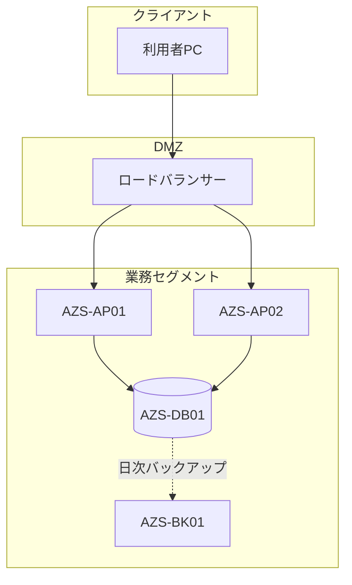

# 機器構成図 — サンプル（記入例）

*記入イメージの例であり、実データではない。空テンプレートは [空テンプレート](<[Template]10-3_機器構成図.md>)、書き方は [使い方](<[使い方]10-3_機器構成図.md>) を参照。*

## 1. システム構成図

## 2. 通信要件

| No. | 送信元（ホスト名） | 送信先（ホスト名） | プロトコル | ポート | 用途 | 備考 |
| --- | ------ | ------ | ---------- | ------ | ---- | ---- |
| 1 | 利用者PC | LB | HTTPS | 443 | 画面アクセス | |
| 2 | AZS-AP01 | AZS-DB01 | TCP | 1521 | DB接続 | |
| 3 | AZS-DB01 | AZS-BK01 | TCP | 445 | バックアップ転送 | 日次 |

## 3. 配置一覧

| No. | 機器 | 設置場所 | ラック | 電源系統 | 備考 |
| --- | ---- | -------- | ------ | -------- | ---- |
| 1 | AZS-DB01 | 本社DC | R-01 | A系 | |

---

## 文書情報

| 大分類 | 小分類 | ドキュメント名 | システムID | システム名 |
| ------ | ------ | -------------- | ---------- | ---------- |
| 10 | 10.3 | 機器構成図 | AZR | 納期管理システム |

## 改定履歴

| Version | 計画書No. | 改訂日     | 改訂内容 | 担当者 | 課題No./備考 |
| ------- | --------- | ---------- | -------- | ------ | ------------ |
| 1.0.0 | K2603-A002 | 2026-09-29 | 新規作成 | KCCS(岡) | - |
