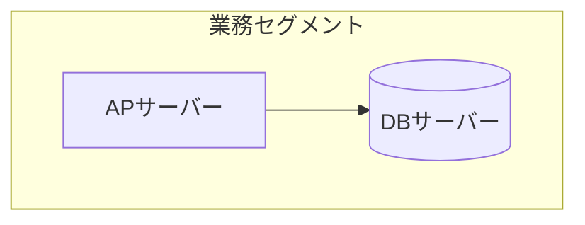
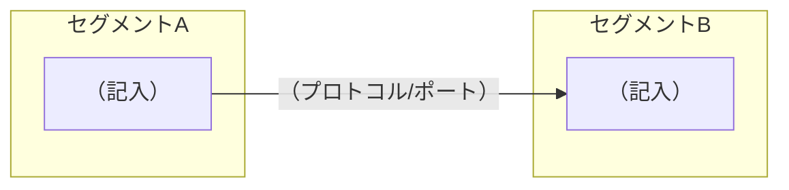

# 機器構成図

*記入用の空テンプレート。書き方は [使い方](<[使い方]10-3_機器構成図.md>)、記入例は [サンプル](<[Sample]10-3_機器構成図.md>) を参照。*

## 1. システム構成図

## 2. ネットワーク構成図

## 3. 通信要件

| No. | 送信元（ホスト名） | 送信先（ホスト名） | プロトコル | ポート | 用途 | 備考 |
| --- | ------ | ------ | ---------- | ------ | ---- | ---- |
| 1 | （記入） | | | | | |

## 4. 配置一覧

| No. | 機器 | 設置場所 | ラック | 電源系統 | 備考 |
| --- | ---- | -------- | ------ | -------- | ---- |
| 1 | （記入） | | | | |

---

## 文書情報

| 大分類 | 小分類 | ドキュメント名 | システムID | システム名 |
| ------ | ------ | -------------- | ---------- | ---------- |
| 10 | 10.3 | 機器構成図 | （記入） | （記入） |

## 改定履歴

| Version | 計画書No. | 改訂日   | 改訂内容 | 担当者   | 課題No./備考 |
| ------- | --------- | -------- | -------- | -------- | ------------ |
| 1.0.0 | K2603-A002 | 2026-09-29 | 新規作成 | KCCS(岡) | - |
